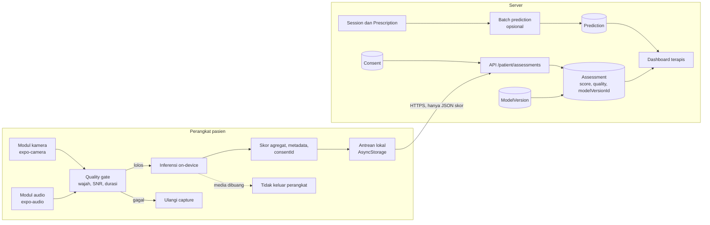
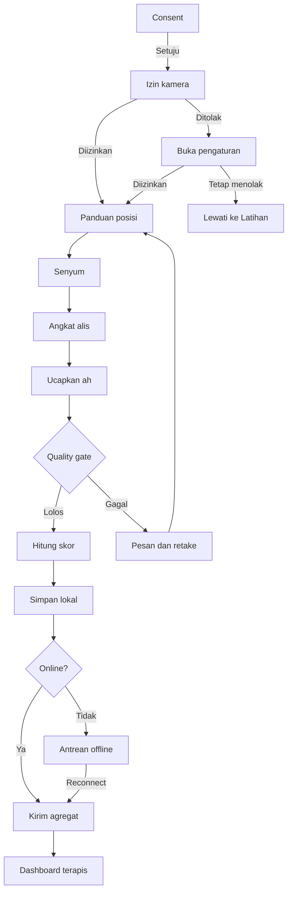
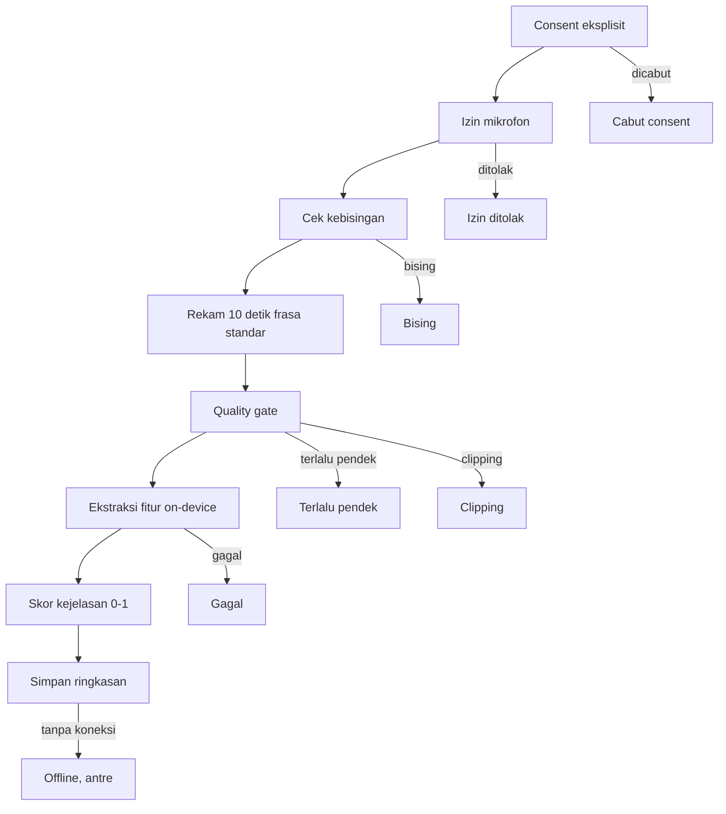
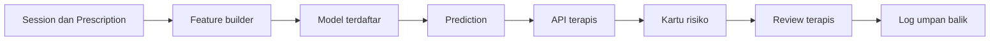
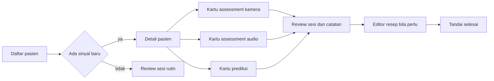

# Rencana Eksekusi Phase 2: Multi-modal Detection

| Item | Keterangan |
|---|---|
| Produk | RehabTrack, sistem monitoring rehabilitasi pasca-stroke |
| Basis | `docs/engineering/roadmap-phase2-3.md`, `docs/engineering/tech-spec.md` bagian 2.1, `docs/planning/mvp-stabilization-plan.md`, dan `docs/proposal/deskripsi-gemastik.md` |
| Status | Draf rencana, belum dieksekusi |
| Timebox | 6 sampai 8 minggu untuk Phase 2, ditambah 6 sampai 8 minggu bila migrasi Flutter dijalankan lebih dulu (total 12 sampai 16 minggu) |
| Asumsi tim | 4 sampai 5 orang, terdiri dari 2 mobile, 1 backend, 1 data/ML, dan 1 design/PM. Migrasi Flutter membutuhkan minimal satu orang dengan pengalaman Dart/Flutter. |

Dokumen ini adalah lanjutan dari rencana stabilisasi MVP pada `docs/planning/mvp-stabilization-plan.md` dan rencana produk pada `docs/engineering/roadmap-phase2-3.md`. Fokusnya adalah eksekusi Phase 2: kamera asimetri wajah, audio disartria, predictive learning, serta fondasi data, consent, dashboard, dan validasi pilot.

Roadmap Phase 2 tidak memiliki entry gate formal. Meskipun demikian, dokumen ini menyarankan urutan de-risking agar pekerjaan multimodal tidak dibangun di atas alur sesi yang masih memiliki utang teknis. Prasyarat tersebut bukan gerbang, melainkan urutan kerja yang menurunkan risiko.

## Daftar Isi

1. Ringkasan dan keputusan
2. Prasyarat dan utang MVP
3. Arsitektur Phase 2
4. Model data, consent, dan API
5. Workstream A: Kamera asimetri wajah
6. Workstream B: Audio disartria
7. Workstream C: Predictive learning
8. Workstream D: Dashboard dan alur klinis
9. Validasi dan pilot
10. Timeline dan milestone
11. Risiko dan mitigasi
12. Definition of done
13. Pemetaan file dan dependensi
14. Workstream E: Migrasi Expo ke Flutter
15. Rujukan

---

## 1. Ringkasan dan keputusan

Phase 2 memperluas RehabTrack dari pelacakan ROM berbasis giroskop menjadi pemantauan multimodal: asimetri wajah dari kamera, kejelasan bicara dari audio, dan prediksi risiko berbasis deret sesi. Roadmap menyatakan Phase 2 boleh dimulai tanpa entry gate. Dokumen ini tetap menyarankan urutan de-risking karena alur sesi MVP masih memiliki utang teknis yang akan memperbesar biaya perbaikan bila dibiarkan.

Tujuh keputusan menjadi dasar rencana:

1. Urutan kerja adalah fondasi, kamera, audio, prediksi, lalu integrasi dan validasi. Setiap workstream memiliki gate internal yang dapat menghentikan atau menunda workstream tanpa menghentikan keseluruhan Phase 2.
2. Kamera tidak diasumsikan berjalan. Keputusan runtime diambil setelah spike 3 sampai 5 hari dengan kriteria performa dan stabilitas yang eksplisit. Bila gagal, kamera ditunda dan audio tetap dilanjutkan.
3. Audio dimulai dari skor deterministik berbasis fitur akustik. Model machine learning hanya dikerjakan bila data pilot mencukupi. Tidak ada klaim akurasi sebelum validasi.
4. Prediksi risiko dijalankan sebagai batch job server-side dengan model sederhana yang dapat dijelaskan. Prediksi adalah saran untuk terapis dan tidak mengubah resep secara otomatis.
5. Pilot 20 pasien selama 8 minggu diperlakukan sebagai studi feasibility. Laporan wajib memuat interval kepercayaan, keterbatasan, dan tidak boleh menyimpulkan efektivitas klinis.
6. Penyimpanan skor agregat di server memerlukan amendemen `tech-spec.md` lebih dulu. Media mentah tetap on-device, dan tanpa amendemen skor tetap lokal.
7. Migrasi Flutter direncanakan sebagai workstream tersendiri dengan prinsip parity-first. Pekerjaan kamera dan audio Phase 2 sebaiknya diimplementasikan di Flutter saja agar tidak dua kali, sehingga total timeline menjadi 12 sampai 16 minggu.

| Workstream | Keluaran utama | Gate | Peran utama |
|---|---|---|---|
| Fondasi | Consent, Assessment, feature flag, antrean offline | G1 | Backend dan mobile |
| Kamera | Skor asimetri, capture UX, quality gate | G1, G2, dan G3 | Mobile dan data/ML |
| Audio | Skor kejelasan, fitur akustik, baseline | G4 | Mobile dan data/ML |
| Prediksi | Label, model baseline, kartu risiko | G5 | Data/ML dan backend |
| Dashboard | Kartu assessment dan prediksi, alur review | G3 dan G6 | Dashboard dan design |
| Validasi | Protokol, pilot, laporan, keputusan Phase 3 | G7 dan G8 | PM, terapis, data/ML |
| Migrasi Flutter | Aplikasi Flutter di `mobile/`, paritas fitur, cutover | G-F1 sampai G-F6 | Mobile dan design |

Lima aksi pertama pada minggu 1:

1. Tutup prasyarat kritis: bug siklus sesi, validasi enum dan angka di server, serta endpoint penugasan pasien ke terapis.
2. Jalankan spike kamera P2-07 dan catat hasil benchmark per perangkat.
3. Finalkan model Consent dan Assessment beserta endpoint minimal, lalu aktifkan feature flag dalam keadaan mati.
4. Tetapkan protokol rekaman audio, quality gate, dan fitur akustik baseline.
5. Kunci definisi label prediksi dan bentuk data yang akan dikumpulkan selama pilot.

Yang tidak termasuk Phase 2: integrasi BPJS, coaching real-time, administrasi multi-klinik, push notification, unggahan media mentah, dan klaim diagnosis. Item tersebut tetap berada di Phase 3 atau di luar scope.


---

## 2. Prasyarat dan utang MVP

Roadmap Phase 2 disetujui tanpa entry gate. Tidak ada rilis MVP, pilot, atau ambang akurasi sebelum implementasi kamera dan audio. Daftar ini bukan gerbang formal, melainkan de-risking dan urutan kerja. Item murah didahulukan. Penundaan dicatat sebagai risiko.

| Item | Status saat ini | Mengapa penting untuk Phase 2 | Referensi |
|---|---|---|---|
| Task 20 uji perangkat fisik | Belum dijalankan | Dev client membawa native module, jadi baseline perangkat nyata harus terbukti lebih dulu. | `docs/planning/mvp-stabilization-plan.md` Task 20 |
| Task 21 validasi target ROM | Belum, tiga target provisional | Skor baru dibaca bersama ROM. Target yang belum divalidasi membuat interpretasi ambigu. | `docs/planning/mvp-stabilization-plan.md` Task 21 |
| Bug siklus sesi | Ada. Reset hanya pada `exercise.key`, timer tetap jalan saat pindah tab | Modul kamera dan audio memakai pola state dan timer yang sama. | `client/screens/ExerciseSession.js` |
| Validasi enum dan angka server | Ada. Hanya `pain` divalidasi | Endpoint assessment butuh validasi ketat, polanya harus disamakan. | `server/routes/sessions.js` |
| Penugasan pasien ke terapis | Belum ada endpoint, `patientIds` dan `assignedTherapistId` tidak sinkron | Consent dan akses harus terikat ke terapis yang benar. | `server/prisma/schema.prisma`, `server/routes/therapist.js` |
| Dashboard reps hardcode | `repsCompleted` selalu dibanding 10 | Skor baru muncul di baris yang sama, label harus dibereskan dulu. | `therapist-dashboard/src/components/SessionLog.jsx` |
| Chart per latihan | Filter hanya di client, detail memuat 8 sesi lintas latihan | Tren asimetri dan audio butuh filter tipe dan jendela waktu. | `server/routes/therapist.js`, `PatientDetail.jsx` |
| i18n | Sebagian, Task 16 ditunda | Teks consent dan hasil harus terbaca dalam Bahasa Indonesia yang konsisten. | `client/i18n.js`, `docs/planning/mvp-stabilization-todo.md` |

Urutan yang disarankan:

1. Sebelum spike kamera: Task 20 terbatas satu perangkat Android, perbaikan bug siklus sesi, penyamaan pola validasi, dan feature flag.
2. Sebelum pilot: Task 21, consent end-to-end, uji tidak ada raw media, dan perbaikan label dashboard. Tanpa ini, data pilot tidak tertafsirkan.
3. Boleh paralel: i18n, chart per latihan, rate limit non-auth, dan telemetri kualitas.

Catatan jadwal: pilot 20 pasien selama 8 minggu berjalan hampir bersamaan dengan Phase 2 6 sampai 8 minggu, sehingga data pilot baru menjadi sinyal awal. Ini asumsi, bukan hasil.

Migrasi Flutter bukan prasyarat Phase 2, tetapi urutan pengerjaan kamera dan audio harus diputuskan lebih dulu. Bila Flutter-first dipilih, task mobile pada workstream kamera dan audio diarahkan ke `mobile/` agar tidak diimplementasikan dua kali.

## 3. Arsitektur Phase 2



Prinsip yang mengikat:

- Raw media dibuang setelah ekstraksi fitur. Frame dan buffer diproses di memori, berkas sementara dihapus pada blok `finally`.
- Server tidak pernah menerima frame, audio, landmark mentah, atau MFCC mentah. API hanya menerima skalar dan metadata.
- Feature flag dapat mematikan seluruh modul Phase 2 tanpa merusak alur inti.
- Offline-first untuk skor. Hasil capture masuk antrean lokal dan disinkronkan dengan `clientRef` sebagai kunci idempotensi.

Komponen: consent service, assessment service, feature flag, model registry, quality gate, local queue, sync worker.

## 4. Model data, consent, dan API

Migrasi `20260813120000_drop_phase2_assessments` menghapus `Assessment` karena belum ada produsen data. Phase 2 memperkenalkannya kembali secara sempit, hanya skor agregat.

Catatan kontrak: `tech-spec.md` §4.5 mencatat penghapusan itu dan §7 menyatakan data kamera dan audio diproses on-device. Rencana ini mengusulkan amendemen terbatas pada kontrak teknis: skor agregat dan metadata boleh disimpan di server, sedangkan frame, audio, landmark, dan MFCC mentah tetap tidak pernah keluar perangkat. Amendemen wajib disetujui dan `tech-spec.md` diperbarui sebelum migrasi P2-03. Tanpa amendemen, skor tetap lokal dan workstream dashboard serta prediksi tidak dapat berjalan.

Consent Phase 2 bersifat operasional: grant dan revoke per tipe, versi teks, dan audit. Ini bukan privacy policy legal penuh atau alur persetujuan formal yang tetap berada di Phase 3 menurut `tech-spec.md` §7.

```prisma
enum ConsentType {
  facial_asymmetry
  speech_clarity
}

enum AssessmentType {
  facial_asymmetry
  speech_clarity
}

enum PredictionType {
  dropout_risk
  adherence_risk
  plateau_risk
  pain_escalation
}

enum ConsentStatus {
  active
  revoked
}

enum ClinicalReviewStatus {
  unreviewed
  acknowledged
  irrelevant
}

model Consent {
  id         String        @id @default(uuid())
  patientId  String
  type       ConsentType
  status     ConsentStatus @default(active)
  version    String
  grantedAt  DateTime      @default(now())
  revokedAt  DateTime?
  createdAt  DateTime      @default(now())
  updatedAt  DateTime      @updatedAt

  patient     Patient      @relation(fields: [patientId], references: [id], onDelete: Cascade)
  assessments Assessment[]

  @@index([patientId, type, status])
}

model Assessment {
  id             String         @id @default(uuid())
  patientId      String
  consentId      String
  type           AssessmentType
  capturedAt     DateTime
  score          Float
  qualityScore   Float?
  durationMs     Int?
  modelVersionId String
  clientRef      String
  qualityFlags   String[]             @default([])
  reviewStatus   ClinicalReviewStatus @default(unreviewed)
  createdAt      DateTime       @default(now())
  updatedAt      DateTime       @updatedAt

  patient      Patient      @relation(fields: [patientId], references: [id], onDelete: Cascade)
  consent      Consent      @relation(fields: [consentId], references: [id])
  modelVersion ModelVersion @relation(fields: [modelVersionId], references: [id])

  @@unique([patientId, clientRef])
  @@index([patientId, type, capturedAt])
  @@index([consentId])
}

model ModelVersion {
  id          String         @id @default(uuid())
  type        AssessmentType
  version     String
  description String?
  isActive    Boolean        @default(false)
  createdAt   DateTime       @default(now())

  assessments Assessment[]
  predictions Prediction[]

  @@unique([type, version])
}

model Prediction {
  id             String               @id @default(uuid())
  patientId      String
  type           PredictionType
  horizonDays    Int
  value          Float
  factors        String[]             @default([])
  featureVersion String?
  modelVersionId String?
  dataCutoff     DateTime?
  reviewStatus   ClinicalReviewStatus @default(unreviewed)
  generatedAt    DateTime             @default(now())
  createdAt      DateTime             @default(now())

  patient      Patient       @relation(fields: [patientId], references: [id], onDelete: Cascade)
  modelVersion ModelVersion? @relation(fields: [modelVersionId], references: [id])

  @@index([patientId, type, generatedAt])
  @@index([reviewStatus])
}
```

Tidak ada kolom biner, JSON bebas, atau path. `Prediction` opsional. `Patient` perlu relasi `consents`, `assessments`, `predictions`.

`ReviewStatus` yang sudah ada tetap dipakai untuk `Session`. `ClinicalReviewStatus` hanya untuk assessment dan prediction agar status review sesi tidak tercampur dengan status tinjauan sinyal baru.

| Method | Path | Auth | Payload | Response | Validasi | Catatan consent |
|---|---|---|---|---|---|---|
| POST | `/patient/consents` | pasien | `{ type, version }` | `201 { consent }` | enum tipe, `version` wajib, tidak ada consent aktif ganda | membuat consent aktif |
| GET | `/patient/consents/active?type=` | pasien | - | `{ active, consent }` | enum tipe | dipakai sebelum capture |
| DELETE | `/patient/consents/:consentId` | pasien | - | `{ consent }` | milik sendiri, idempoten | status menjadi `revoked` |
| POST | `/patient/assessments` | pasien | `{ type, score, capturedAt, clientRef, modelVersion, qualityScore?, qualityFlags?, durationMs? }` | `201 { assessment }` | skor 0 sampai 1, enum tipe, consent aktif, versi model terdaftar, rate limit 30 per jam | `consentId` diisi server |
| GET | `/patient/assessments?type=&limit=` | pasien | - | `{ assessments }` | limit 1 sampai 50 | riwayat tampil, submission baru diblokir |
| GET | `/therapist/patients/:patientId/assessments?type=` | terapis | - | `{ assessments }` | pasien ada di `patientIds` | historis tetap tampil |
| PATCH | `/therapist/patients/:patientId/assessments/:id/review` | terapis | `{ reviewStatus }` | `{ assessment }` | enum `ClinicalReviewStatus` | tidak mengubah consent |
| PATCH | `/therapist/patients/:patientId/predictions/:id/review` | terapis | `{ reviewStatus }` | `{ prediction }` | enum `ClinicalReviewStatus` | aksi review prediksi |
| DELETE | `/patient/assessments?type=` | pasien | - | `{ deleted }` | enum tipe | penghapusan atas permintaan |

Aturan validasi: skor 0 sampai 1, tolak `NaN` dan string numerik. `capturedAt` maksimal 24 jam ke depan dan 30 hari ke belakang. Retry memakai `clientRef` sama dan mengembalikan `200` bila pasangan sudah ada. Pencabutan consent memblokir submission baru tanpa menghapus skor lama.

Seed `ModelVersion` wajib menyertakan baseline per metode, misalnya `facial-vision-v1`, `audio-mfcc-v1`, dan `rules-v1`. Submission tanpa versi terdaftar ditolak agar skor lama tetap dapat ditafsirkan.

Urutan migrasi: `add_consent`, `add_model_version`, `add_assessment`, lalu `add_prediction`. Tanpa backfill, flag default mati. Monitoring: submission per tipe, penolakan quality gate, laju 4xx, consent aktif. Retensi: skor disimpan selama pasien aktif, media mentah tidak, penghapusan menghapus skor dan prediction, jejak consent menjadi audit.

Definisi selesai fondasi: migrasi berjalan di CI, endpoint inti punya test, consent gate diuji untuk kasus tidak ada dan dicabut, flag mati tidak mengubah alur MVP, dan tidak ada media di database maupun log.

#### P2-01: Feature flag dan konfigurasi Phase 2
**Description:** Tambahkan feature flag kamera, audio, dan predictive learning. Default mati dan tidak boleh membuat alur MVP gagal.
**Acceptance criteria:**
- [ ] Flag `PHASE2_FACE`, `PHASE2_AUDIO`, `PHASE2_PREDICTION` tersedia dan diekspos lewat endpoint konfigurasi.
- [ ] Dengan semua flag mati, alur latihan, sesi, catatan, dan progres tidak berubah.
**Verification:**
- [ ] Uji alur MVP dengan flag mati dan bandingkan dengan baseline.
- [ ] Uji endpoint konfigurasi untuk tiga kombinasi flag.
**Dependencies:** Tidak ada.
**Files likely touched:** `server/routes/config.js`, `client/utils/featureFlags.js`, `client/.env.example`.

**Estimated scope:** Small.

#### P2-02: Consent model, endpoint, dan UI consent
**Description:** Tambahkan model `Consent` dengan endpoint grant, revoke, status aktif, lalu UI consent sebelum capture pertama. Consent per tipe dan dapat dicabut.
**Acceptance criteria:**
- [ ] Tiga endpoint consent berfungsi dan ter-scope ke pasien JWT.
- [ ] Consent aktif ganda per tipe ditolak.
- [ ] UI menjelaskan tujuan, status bukan diagnostik, dan cara mencabut.
- [ ] Capture diblokir tanpa consent aktif.
**Verification:**
- [ ] Test grant, duplikat, revoke, dan akses pasien lain.
- [ ] Uji manual consent lalu capture pada dev client.
**Dependencies:** P2-01.
**Files likely touched:** `server/prisma/schema.prisma`, `server/routes/consents.js`, `client/screens/ConsentScreen.js`, `client/api/client.js`.

**Estimated scope:** Medium.

#### P2-03: Assessment model, migrasi, endpoint, dan validasi
**Description:** Tambahkan model `Assessment` dan `ModelVersion`, migrasi, endpoint submission dan pembacaan dengan validasi ketat. Tidak ada kolom media, `consentId` diisi server.
**Acceptance criteria:**
- [ ] Migrasi membuat tabel dan index `(patientId, type, capturedAt)`.
- [ ] Seed `ModelVersion` baseline tersedia dan submission menolak versi yang tidak terdaftar.
- [ ] Submission menolak skor di luar 0 sampai 1, tipe tidak dikenal, dan consent tidak aktif.
- [ ] Retry dengan `clientRef` sama mengembalikan `200` tanpa baris ganda.
**Verification:**
- [ ] `prisma validate` dan `prisma migrate deploy` pada database test.
- [ ] Test validasi dan idempotensi dua request identik.
**Dependencies:** P2-02.
**Files likely touched:** `server/prisma/schema.prisma`, `server/prisma/migrations/`, `server/routes/assessments.js`, `server/utils/validation.js`.

**Estimated scope:** Medium.

#### P2-04: Kontrak modul assessment on-device, antrean lokal, dan sync
**Description:** Definisikan antarmuka capture dan inferensi yang seragam, simpan hasil di antrean lokal, lalu sinkronkan seperti sesi giroskop.
**Acceptance criteria:**
- [ ] Kontrak `capture -> qualityGate -> infer -> aggregate` mengembalikan tipe, skor, `qualityScore`, `qualityFlags`, `modelVersion`, `durationMs`, dan `clientRef` tanpa media.
- [ ] Hasil capture tersimpan lokal sebelum upload dan bertahan saat aplikasi ditutup.
- [ ] Sync mengirim ulang item tertunda dan melewati item yang sudah tersinkron.
- [ ] Quality gate gagal meminta capture ulang, bukan mengirim skor rendah.
**Verification:**
- [ ] Test unit kontrak dan pembentukan `clientRef`.
- [ ] Uji offline lalu reconnect pada dev client.
**Dependencies:** P2-03.
**Files likely touched:** `client/utils/assessment/contract.js`, `client/utils/assessmentQueue.js`, `client/api/client.js`, `client/screens/AssessmentCapture.js`.

**Estimated scope:** Large.

#### P2-05: Privasi, retensi, penghapusan, dan uji tidak ada raw media
**Description:** Tegakkan privasi: media dibuang setelah ekstraksi fitur, log tidak memuat isi media, pasien dapat menghapus skornya.
**Acceptance criteria:**
- [ ] Tidak ada kolom biner, path berkas, atau JSON media pada skema.
- [ ] Log server dan client tidak mencetak base64, URI sementara, atau isi audio.
- [ ] `DELETE /patient/assessments?type=` menghapus skor dan prediction terkait.
- [ ] Berkas sementara dihapus pada blok `finally`.
**Verification:**
- [ ] Test memindai skema dan payload untuk field terlarang.
- [ ] Test error capture memeriksa log dan hasil penghapusan.
**Dependencies:** P2-03, P2-04.
**Files likely touched:** `server/routes/assessments.js`, `client/utils/assessment/cleanup.js`, `server/scripts/privacy.test.js`.

**Estimated scope:** Medium.

#### P2-06: Telemetri kualitas assessment tanpa PII
**Description:** Kumpulkan metrik agregat kualitas capture dan inferensi, tanpa identitas pasien, media, atau teks bebas.
**Acceptance criteria:**
- [ ] Metrik mencakup rasio lolos quality gate, durasi capture, versi model, dan kode kegagalan.
- [ ] Tidak ada `patientId`, `email`, `name`, atau `clientRef` pada payload.
- [ ] Telemetri mati saat flag Phase 2 mati.
**Verification:**
- [ ] Test skema payload menolak field terlarang.
**Dependencies:** P2-01, P2-04.
**Files likely touched:** `server/routes/telemetry.js`, `server/prisma/schema.prisma`, `client/utils/assessment/telemetry.js`.

**Estimated scope:** Small.

---

## 5. Workstream A: Kamera asimetri wajah

### 5.1 Lingkup dan non-goals

Workstream ini menambahkan pemeriksaan asimetri wajah terpandu sebagai sinyal pelengkap. Keluarannya skor 0 sampai 1 (1 simetris), status kualitas, metode, dan versi model. Bukan diagnosis.

Lingkup:

- Satu sesi tiga tugas: senyum, angkat alis, dan ucapan "ah", 15 sampai 25 detik. Status: rencana.
- Frame, video, dan landmark mentah diproses on-device. Hanya agregat (skor, kualitas, metode, versi model) yang dikirim dan tampil di dashboard. Status: rencana, sesuai `tech-spec.md` §7 dan §10.
- Consent eksplisit sebelum kamera aktif, dengan versi teks dan timestamp, serta feature flag default mati. Status: rencana, tabel Consent dan mekanisme flag belum ada.

Sudah ada: `expo-dev-client` dan folder native `android`. `expo-camera`, izin kamera, dan feature flag belum ada, `app.json` memuat `NSMotionUsageDescription`. Prisma belum memiliki tabel `Consent` atau `Assessment`. `tech-spec.md` §4.5 mencatat `Assessment` dihapus pada migrasi `20260813120000`, sehingga skema diselaraskan.

Non-goals:

- Mendiagnosis stroke, melokalisasi lesi, menilai keparahan, atau menggantikan terapis.
- Menggantikan pemeriksaan fisik.
- Menyimpan atau mengunggah frame, video, dan landmark mentah.
- Audio dan umpan balik real time, yang berada di workstream lain atau Phase 3.
- Multi-wajah, pose ekstrem, populasi anak, dan pelatihan model baru.

### 5.2 Alur pengguna

Alur menghubungkan consent, izin, posisi, tiga tugas, quality gate, skor, penyimpanan, dan dashboard.



State wajib:

- Izin ditolak: jelaskan, sediakan tombol pengaturan, izinkan melewati.
- Cahaya kurang: minta menambah cahaya, tanpa menyalahkan perangkat.
- Wajah tidak terdeteksi: tampilkan bingkai dan batas waktu.
- Gerakan berlebih: deteksi variasi pose, minta menahan, ulangi tugas.
- Retake: ulangi satu tugas atau sesi, hasil valid dipertahankan.
- Offline: simpan lokal, tampilkan "Tersimpan, akan disinkron nanti", kirim saat aktif.

### 5.3 Keputusan teknis dan spike

Persetujuan dependensi di `tech-spec.md` §2.1 bukan klaim production-ready, sehingga keputusan menunggu spike.

| Opsi | Komposisi | Kelebihan | Risiko |
|---|---|---|---|
| A | `react-native-vision-camera-face-detector` dengan `react-native-vision-camera` dan worklets | Native, latensi rendah, landmark kontinu | Konfigurasi native, binary membesar, kompatibilitas SDK 57/RN 0.86, beban low-end |
| B | `expo-camera` still frame dengan `@mediapipe/tasks-vision` lewat native module atau WebView | API izin dan kamera sederhana | Latensi still frame, jembatan WebView, model/WASM berat |
| C | Tunda kamera, fokus ke audio | Risiko terendah | Kehilangan klaim multimodal, keputusan tertunda |

Spike 3 sampai 5 hari pada perangkat fisik: satu Android menengah, satu low-end, dan satu iOS bila ada. Skenario: preview 20 detik dan satu sesi penuh.

| Kriteria go/no-go | Ambang |
|---|---|
| FPS | minimal 10 FPS stabil |
| Latensi | p95 di bawah 300 ms |
| Confidence landmark | ambang sama semua opsi |
| Stabilitas | tanpa crash/ANR pada 3 sesi |
| Ukuran binary | maksimal +20 MB, provisional |
| Izin | hanya kamera, tanpa mikrofon |
| Expo SDK 57 | dev client dapat dibangun ulang |

Memo memuat pengukuran, rekomendasi, dan risiko sisa. Bila tidak ada yang lolos, pilih C.

### 5.4 Metrik dan perhitungan skor

Indeks Face Mesh 468 titik wajib diverifikasi saat spike.

| Grup | Pasangan indeks |
|---|---|
| Mata | 33 dan 263, 133 dan 362, 159 dan 386, 145 dan 374 |
| Alis | 70 dan 300, 63 dan 293, 105 dan 334 |
| Mulut | 61 dan 291, 78 dan 308, 87 dan 317 |
| Rahang | 172 dan 397, 132 dan 361, 58 dan 288, 150 dan 379 |

Midline melalui 168 dan 152. Normalisasi memakai IOD (33 dan 263), lebar wajah (234 dan 454) hanya uji sensitivitas.

```text
midline: garis p168-p152
d_Li, d_Ri: jarak tegak lurus ke midline
IOD = ||p33 - p263||
a_i = |d_Li - d_Ri| / IOD
A_frame = sum(w_i * a_i) / sum(w_i)
A_task = median(A_frame frame valid)
A_session = median(A_senyum, A_alis, A_bicara)
skor = 1 - clamp(k * A_session, 0, 1)
```

Bobot `w_i` dan `k` provisional, ditetapkan pada P2-11. Median mencegah outlier. Skor 1 simetris.

| Quality gate | Ambang awal |
|---|---|
| Ukuran wajah | tinggi bounding box minimal 30 persen frame |
| Yaw | maksimal 15 derajat |
| Roll | maksimal 10 derajat |
| Blur | varians Laplacian di atas ambang per resolusi |
| Pencahayaan | rata-rata 40-220 (skala 0-255), saturasi di bawah 5 persen |
| Frame valid | minimal 15 frame per tugas |

Bila gagal, skor tidak dikirim dan alasan disimpan. Ambang provisional.

### 5.5 Validasi

Rancangan feasibility: 20 pasien, 8 minggu. Terapis menilai visual dan tersamar. Skala referensi disepakati sebelum pendaftaran, misalnya Sunnybrook, tetapi belum final.

Definisi agreement ditetapkan sebelum pasien pertama:

- Klasifikasi biner "asimetri signifikan" dengan ambang yang dibekukan.
- Persentase agreement, Cohen kappa, sensitivitas, dan spesifisitas.
- Interval kepercayaan 95 persen, Wilson untuk proporsi dan bootstrap untuk kappa.
- Pelaporan per tugas dan data tidak memadai.

Target awal, bukan hasil: agreement minimal 75 persen, kappa minimal 0,6, sensitivitas dan spesifisitas minimal 0,7. Angka provisional dibekukan sebelum pendaftaran. Studi tidak powered untuk presisi tinggi, sehingga CI lebar dan bukan klaim publik.

Task 20 dan Task 21 sebelum pilot, bukan prasyarat coding.

### 5.6 Risiko dan mitigasi

| Risiko | Dampak | Mitigasi |
|---|---|---|
| Runtime belum production-ready | Tinggi | Spike, decision gate, opsi C |
| Performa low-end | Sedang | Uji target, batasi resolusi/FPS |
| Bias pencahayaan dan pose | Tinggi | Quality gate, panduan pose |
| Privasi frame wajah | Tinggi | On-device, consent, audit jaringan |
| Overclaim klinis | Tinggi | Label pelengkap, copy non-diagnostik |
| Dependency native | Sedang | Kunci versi, dev client, build bersih |
| Variasi anatomi | Sedang | Uji IOD/lebar wajah, tinjau terapis |

#### P2-07: Spike dan decision gate kamera

**Description:** Ukur opsi A, B, dan C pada perangkat fisik, lalu putuskan arah implementasi.

**Acceptance criteria:**
- [ ] FPS, latensi p50/p95, memori, crash, dan selisih binary per opsi dan perangkat.
- [ ] Dua Android, satu low-end, plus iOS bila ada.
- [ ] Ketujuh kriteria dinilai dengan angka dan memo memuat risiko sisa.

**Verification:**
- [ ] Memo ditinjau anggota tim lain.
- [ ] Build dev client bersih dapat diulang dari branch spike.

**Dependencies:** Persetujuan `tech-spec.md` §2.1. Tidak bergantung pada Task 20 atau 21.

**Files likely touched:** `docs/engineering/phase2-camera-spike.md`, branch spike, `client/package.json` selama spike.

**Estimated scope:** Medium.

#### P2-08: Alur capture, consent, izin, dan quality checks

**Description:** Bangun layar dengan consent, izin, panduan, tiga tugas, quality gate, state, dan retake. Belum menghitung skor.

**Acceptance criteria:**
- [ ] Consent mencatat versi teks dan timestamp sebelum kamera aktif.
- [ ] Enam state memiliki copy Bahasa Indonesia dan alasan yang ditindaklanjuti; tidak ada frame keluar perangkat.
- [ ] Touch target minimal 48 piksel dan teks minimal 16 piksel.

**Verification:**
- [ ] Uji keenam state, mode pesawat, dan penolakan izin permanen.
- [ ] Unit test quality gate dengan fixture sintetis lulus.

**Dependencies:** P2-07, tinjauan desain alur.

**Files likely touched:** `client/screens/FaceAsymmetryScreen.js`, `client/components/face/`, `client/utils/faceQuality.js`, `client/i18n.js`, `client/app.json`, `client/App.js`.

**Estimated scope:** Large.

#### P2-09: Ekstraksi landmark, normalisasi, skor, dan unit test fixture sintetis

**Description:** Implementasikan fungsi murni untuk pasangan landmark, jarak ke midline, IOD, median, dan skor 0 sampai 1 tanpa React Native.

**Acceptance criteria:**
- [ ] Pasangan landmark dan midline terdokumentasi.
- [ ] Wajah simetris mendekati 1, offset asimetris lebih rendah, landmark hilang bukan NaN.
- [ ] Median tahan terhadap satu frame outlier.
- [ ] Bobot dan `k` provisional serta berasal dari satu konfigurasi.

**Verification:**
- [ ] `node --test client/utils/faceAsymmetry.test.js` lulus.
- [ ] Fixture mencakup simetris, asimetris, hilang, dan outlier.
- [ ] Rumus kode cocok dengan 5.4.

**Dependencies:** P2-07 untuk sumber landmark. Paralel dengan P2-08.

**Files likely touched:** `client/utils/faceAsymmetry.js`, `client/utils/faceAsymmetry.test.js`, `client/utils/fixtures/faceLandmarks/`.

**Estimated scope:** Medium.

#### P2-10: Integrasi on-device, antrean offline, simpan Assessment, dan feature flag

**Description:** Sambungkan inference, simpan agregat, antrekan offline, kirim ke API, tampilkan di dashboard.

**Acceptance criteria:**
- [ ] Hanya skor, kualitas, metode, versi model, dan waktu yang dikirim; API menolak data mentah.
- [ ] Offline tersimpan lokal dan sinkron saat reconnect; flag mematikan alur tanpa merusak MVP.
- [ ] Keputusan skema Assessment didokumentasikan dan `tech-spec.md` §4.5 diperbarui sebelum migrasi.
- [ ] Skor tidak dikirim bila quality gate gagal; dashboard berlabel "sinyal pelengkap, bukan diagnosis".

**Verification:**
- [ ] Test API menolak payload mentah dan uji offline/reconnect.
- [ ] Migrasi Prisma dan rollback diuji; regresi giroskop dengan flag mati lulus.

**Dependencies:** P2-08, P2-09, pembaruan `tech-spec.md`.

**Files likely touched:** `client/utils/faceInference.js`, `client/utils/storage.js`, `client/api/client.js`, `server/prisma/schema.prisma`, `server/prisma/migrations/`, `server/routes/patient.js`, `therapist-dashboard/src/`, `docs/engineering/tech-spec.md`.

**Estimated scope:** Large.

#### P2-11: Harness validasi internal, protokol, dan dry run relawan sehat

**Description:** Siapkan protokol beku, harness ekspor terdeidentifikasi, dan dry run relawan sehat.

**Acceptance criteria:**
- [ ] Protokol memuat agreement, ambang, kappa, sensitivitas, spesifisitas, dan CI.
- [ ] Penilaian tersamar dan skala referensi disepakati sebelum pasien pertama.
- [ ] Harness mengekspor agregat terdeidentifikasi; dry run lima relawan mencatat penolakan dan waktu.
- [ ] Protokol menyatakan studi 20 pasien feasibility dan tidak powered; Task 20 dan 21 sebelum pilot.

**Verification:**
- [ ] Protokol disetujui tertulis terapis mitra.
- [ ] Ekspor CSV dihitung ulang independen; laporan dry run memuat tindak lanjut usability.

**Dependencies:** P2-10. Task 20 dan 21 untuk pelaksanaan pilot.

**Files likely touched:** `docs/engineering/phase2-camera-validation-protocol.md`, `server/scripts/`, `docs/manuals/`.

**Estimated scope:** Medium.

---

## 6. Workstream B: Audio disartria

### 6.1 Lingkup dan non-goals

Audio menghasilkan skor kejelasan 0 sampai 1 dan pita risiko rendah, sedang, atau tinggi sebagai sinyal pelengkap, bukan diagnosis atau pengganti terapis. Skor disertai rincian fitur.

Lingkup: consent eksplisit, rekaman 10 detik frasa standar, quality gate, ekstraksi fitur on-device, skor baseline deterministik, ringkasan, tampilan dashboard, harness validasi. Non-goals: unggah audio mentah, pemrosesan server, speech-to-text, penilaian bahasa, klaim diagnosis, dan ketergantungan rilis pada model terlatih. Status: `expo-audio` baru dipakai untuk memutar isyarat di `client/utils/soundManager.js`. Belum ada rekaman, consent, fitur, skor, atau tabel baru. Baseline masih rencana, belum divalidasi, tanpa dataset internal.

### 6.2 Alur pengguna dan consent

Consent diminta sebelum izin mikrofon karena audio lebih sensitif daripada giroskop. Layar menjelaskan audio diproses on-device, tidak diunggah, file sementara dihapus setelah ekstraksi, dan consent dapat dicabut tanpa kehilangan akses latihan. Consent mencatat versi, waktu, status. Pencabutan menghentikan perekaman dan menghapus file.



State wajib: izin ditolak (tautan pengaturan), bising, terlalu pendek, clipping, gagal, offline (antrean lokal), dan cabut consent (hapus file). Tidak ada perekaman otomatis.

### 6.3 Fitur akustik dan skor baseline

Fitur dihitung dari sinyal 16 kHz mono, frame 25 ms, hop 10 ms. Relevansi berikut literatur, bukan hasil pilot.

| Fitur | Perhitungan dan relevansi disartria |
|---|---|
| MFCC 13 + delta | Filterbank 26 kanal, DCT 13, delta; amplop spektral dan dinamika artikulasi |
| f0 | Autokorelasi atau YIN; pitch dan variasi intonasi |
| Jitter | Variasi periode antar siklus; ketidakstabilan pita suara |
| Shimmer | Variasi amplitudo antar siklus; kelemahan dan napas berlebih |
| HNR | Harmonik dibanding derau; suara berdesir menurunkan HNR |
| Speech rate | Suku kata per detik; bicara melambat |
| Pause ratio | Proporsi frame hening; jeda berlebihan |
| Spectral centroid | Pusat massa spektrum; ketajaman konsonan |

Baseline memakai deviasi fitur terhadap referensi sehat provisional, dipetakan 0 sampai 3, digabung dengan bobot awal sama, lalu diubah menjadi skor kejelasan. Risiko dihitung sebagai komplemen, `risk = 1 - clarity`. Pita risiko: di bawah 0,33 rendah, 0,33 sampai 0,67 sedang, di atas 0,67 tinggi; ambang provisional.

```javascript
const d = (x, ref, s, dir) => Math.min(Math.max(dir * (x - ref) / s, 0), 3);
const dev = features.reduce((a, f) => a + f.w * d(f.x, f.ref, f.s, f.dir), 0)
  / features.reduce((a, f) => a + f.w, 0);
const clarity = 1 - 1 / (1 + Math.exp(-6 * (dev - 0.9)));
```

Keterbatasan: referensi belum dari penutur Indonesia, bobot belum dikalibrasi, skor sensitif terhadap mikrofon dan jarak, derau menekan HNR secara palsu, dan skor tidak sebanding antar perangkat.

ML opsional setelah data pilot cukup. Dataset publik seperti TORGO atau UA-Speech punya isu lisensi, domain mismatch, dan label tidak seragam, jadi bukan sumber utama. Model harus mengalahkan baseline pada data uji dengan CI, jika tidak baseline tetap jalur rilis.

### 6.4 Runtime on-device

Perekaman memakai `expo-audio` di dev client; runtime native dan `expo-gl` tidak dijamin di Expo Go. Target PCM WAV 16 kHz mono agar dapat didekode di JS. Format SDK 57 diverifikasi dulu; bila WAV tidak tersedia, AAC didekode lewat jalur native atau pustaka disetujui. Ekstraksi fitur berjalan di JS murni. `@tensorflow/tfjs` dengan `@tensorflow/tfjs-react-native` dan `expo-gl` hanya dipakai bila spike lolos decision gate. Fallback tanpa model selalu tersedia.

Benchmark berikut target, bukan hasil. Metode: audio 10 detik, Android kelas menengah tiga tahun, lima pengulangan, median dan p95.

| Metrik | Target |
|---|---|
| Ekstraksi fitur | < 2 detik, termasuk decode dan MFCC |
| Memori puncak | < 150 MB saat ekstraksi atau inferensi |
| Ukuran model | <= 5 MB bila jalur ML dipakai |
| Cold start | <= 300 ms dengan lazy load |
| Kompatibilitas | SDK 57, RN 0.86, dev client; bukan Expo Go |

Audio mode dipulihkan setelah rekaman. Kegagalan model tidak menampilkan error keras; aplikasi kembali ke baseline dan memberi label sumber skor.

### 6.5 Validasi

Rencana: 20 pasien, 8 minggu, feasibility. Terapis menilai dengan skala disartria, misalnya FDA-2, tersamar terhadap skor aplikasi. Definisi agreement ditetapkan sebelum analisis. Primer: kesesuaian biner pita risiko dengan penilaian terapis, target minimal 75 persen dengan CI 95 persen, dibaca sebagai target. Sekunder: kappa Cohen, ICC, sensitivitas dan spesifisitas pada ambang terpilih, dengan CI. Laporkan test-retest dan distribusi mikrofon.

Dengan 20 pasien, CI lebar dan stratifikasi subkelompok terbatas. Hasil hanya untuk kelayakan, perbaikan protokol, dan kalibrasi ambang. Prasyarat pilot: Task 20 uji perangkat fisik dan Task 21 validasi target ROM sebaiknya selesai dulu.

### 6.6 Risiko dan mitigasi

| Risiko | Dampak | Mitigasi | Status |
|---|---|---|---|
| Kualitas rekaman rendah | Skor tidak stabil | Gate, panduan jarak, rekam ulang | Rencana |
| Variasi mikrofon | Skor tidak sebanding | Normalisasi level, kalibrasi | Rencana |
| Bias bahasa dan aksen | Frasa tidak representatif | Frasa Indonesia, penutur beragam | Belum ada |
| Overclaim | Skor dianggap diagnosis | Label pelengkap, rincian fitur | Wajib |
| Privasi audio | Rekaman bocor | On-device, hapus file, consent | Wajib |
| Runtime tfjs gagal | Fitur tidak jalan | Fallback baseline, decision gate | Rencana |
| Dataset internal tidak ada | Model tidak dilatih | Baseline jalur utama | Fakta |
| Consent tidak tercatat | Tidak ada bukti izin | Consent berversi, audit | Belum ada |

#### P2-12: Consent, protokol rekaman, dan quality gate

**Description:** Bangun consent berversi, izin mikrofon, protokol rekaman 10 detik, dan quality gate untuk rekaman pendek, clipping, atau bising. Semua state 6.2 harus terlihat dan dapat dipulihkan.

**Acceptance criteria:**
- [ ] Consent mencatat versi, waktu, status, dan dapat dicabut; rekaman hanya dimulai setelah consent dan izin.
- [ ] Gate menolak durasi bersuara kurang dari 6 detik, clipping di atas 1 persen, dan derau di atas ambang awal.
- [ ] File sementara dihapus setelah ekstraksi atau pembatalan; tidak ada audio mentah di jaringan.
- [ ] Tujuh state di 6.2 memiliki pesan Bahasa Indonesia.

**Verification:**
- [ ] Unit test gate dengan sinyal sintetis dan fixture WAV.
- [ ] Uji manual di Android dan iOS.

**Dependencies:** Tech-spec 2.1, Task 20. Versi lokal tanpa tabel server.

**Files likely touched:** `client/screens/SpeechCheckScreen.js`, `client/components/ConsentSheet.js`, `client/utils/audioConsent.js`, `client/utils/audioQuality.js`, `client/i18n.js`, `client/utils/storage.js`.

**Estimated scope:** Medium.

#### P2-13: Library ekstraksi fitur dan unit test sinyal sintetis

**Description:** Implementasikan dekode WAV, MFCC 13 plus delta, f0, jitter, shimmer, HNR, speech rate, pause ratio, dan spectral centroid sebagai modul JS deterministik.

**Acceptance criteria:**
- [ ] Buffer 16 kHz mono menghasilkan vektor fitur berdimensi tetap.
- [ ] Nilai fitur sinus, derau, dan hening sesuai rentang yang diharapkan.
- [ ] Tidak ada dependensi native baru di luar yang disetujui.
- [ ] Ekstraksi 10 detik audio di bawah 2 detik.

**Verification:**
- [ ] Unit test sinus 220 Hz, derau putih, hening, campuran, dan determinisme.
- [ ] Benchmark median dan p95 dicatat.

**Dependencies:** P2-12 untuk format rekaman. Kesepakatan format WAV.

**Files likely touched:** `client/utils/audio/wav.js`, `client/utils/audio/features.js`, `client/utils/audio/fft.js`, `client/utils/audio/__tests__/`.

**Estimated scope:** Medium.

#### P2-14: Skor baseline dan rencana kalibrasi

**Description:** Implementasikan skor deterministik, pita risiko, dan rincian kontribusi fitur. Siapkan rencana kalibrasi dengan data pilot.

**Acceptance criteria:**
- [ ] Skor dan pita risiko dihitung dari konfigurasi bobot yang dapat diubah.
- [ ] Output memuat kontribusi fitur dan alasan penolakan gate.
- [ ] Bobot dan ambang ditandai provisional di kode dan UI.
- [ ] Rencana kalibrasi memuat pembagian data, metrik, dan kriteria stop.

**Verification:**
- [ ] Unit test fitur normal, batas, dan nilai ekstrem.
- [ ] Review rencana oleh data/ML dan terapis, tanpa klaim akurasi sebelum data pilot.

**Dependencies:** P2-13. Belum ada dataset internal.

**Files likely touched:** `client/utils/audio/score.js`, `client/utils/audio/scoreConfig.js`, `docs/planning/audio-calibration.md`.

**Estimated scope:** Medium.

#### P2-15: Spike model on-device, benchmark, dan decision gate

**Description:** Uji model kecil dengan `@tensorflow/tfjs`, `@tensorflow/tfjs-react-native`, dan `expo-gl`, atau runtime lebih ringan. Timebox dan putuskan kelanjutan.

**Acceptance criteria:**
- [ ] Model dummy atau publik berlisensi jelas dimuat di dev client.
- [ ] Benchmark mencatat inferensi, memori, ukuran model, dan cold start.
- [ ] Ada perbandingan ML dan baseline.
- [ ] Decision gate: lanjut hanya bila ada bukti keunggulan pada data uji.

**Verification:**
- [ ] Uji pada minimal dua perangkat fisik SDK 57.
- [ ] Uji fallback saat model gagal dimuat dan catat lisensi model.

**Dependencies:** P2-13, P2-14, dev client. Tidak bergantung dataset internal.

**Files likely touched:** `client/utils/audio/modelRuntime.js`, `client/assets/models/`, `docs/planning/audio-model-spike.md`.

**Estimated scope:** Medium.

#### P2-16: Integrasi, antrean offline, penyimpanan Assessment, dan harness validasi

**Description:** Hubungkan alur audio ke sesi, simpan ringkasan lokal dan sinkronkan saat online, tampilkan di dashboard, dan bangun harness validasi pilot 20 pasien.

**Acceptance criteria:**
- [ ] Skor dan rincian fitur tersimpan lokal tanpa audio mentah, tampil di dashboard, tanpa audio di server atau log.
- [ ] Antrean offline menyinkronkan ringkasan saat online dan menangani 401.
- [ ] Model `Consent` dan `Assessment` atau kontrak penyimpanan disetujui sebelum migrasi.
- [ ] Harness mengekspor data tersamar untuk agreement, kappa, sensitivitas, spesifisitas, CI.

**Verification:**
- [ ] Uji integrasi consent sampai simpan dalam mode offline.
- [ ] Pemeriksaan payload dan log bebas audio.
- [ ] Uji harness dengan data sintetis dan pastikan metrik serta CI keluar.

**Dependencies:** P2-12, P2-14, dan P2-15 bila jalur ML dipakai. Task 20 dan Task 21 untuk pilot. Persetujuan perubahan skema.

**Files likely touched:** `client/screens/SpeechCheckScreen.js`, `client/utils/storage.js`, `client/api/client.js`, `server/prisma/schema.prisma`, `server/routes/`, `therapist-dashboard/src/pages/PatientDetail.jsx`, `docs/planning/audio-validation.md`.

**Estimated scope:** Large.

---

## 7. Workstream C: Predictive learning

### 7.1 Lingkup dan non-goals

Workstream ini merencanakan prediksi penurunan kepatuhan, plateau ROM, dan eskalasi nyeri dari data `Session` yang ada. Statusnya rencana: belum ada model terlatih, skema `Prediction`, atau klaim kinerja.

Non-goals: bukan diagnosis, bukan pengganti keputusan terapis (keluaran adalah saran), bukan prediksi real-time, tidak mengubah resep secara otomatis.

Prasyarat: Task 20 (uji perangkat fisik) dan Task 21 (validasi target ROM) sebaiknya selesai sebelum pilot. Endpoint penugasan pasien-terapis dan validasi server ditutup lebih dulu. Otorisasi dashboard memakai `Therapist.patientIds`; `Patient.assignedTherapistId` belum dipakai.

### 7.2 Label dan definisi operasional

Label dihitung pada titik `t` dengan horizon `h`: fitur hanya dari `date <= t`, label dari kejadian di `(t, t+h]`. Semua ambang provisional.

| Label | Definisi | Horizon | Sumber | Catatan |
|---|---|---|---|---|
| Dropout | Tidak ada sesi dalam 7 hari setelah sesi terakhir | 7 hari | `Session.date` | Sinkronisasi tertunda dapat menjadi positif palsu |
| Kepatuhan rendah | Kurang dari 3 sesi per minggu selama 2 minggu | 14 hari | `Session.date`, `Prescription` | Pasien tanpa resep aktif dikeluarkan |
| Plateau ROM | Kemiringan `peakRom` datar atau negatif 3 minggu, minimal 4 sesi | 21 hari | `Session.peakRom` | Ambang derajat per minggu perlu keputusan klinis |
| Nyeri meningkat | Proporsi `mild` atau `stopped` naik, atau dua sesi `stopped` berurutan | 14 hari | `Session.pain` | Tidak menangkap intensitas |
| Batas aman berulang | `ceilingHits` lebih dari nol pada dua sesi atau lebih | 14 hari | `Session.ceilingHits` | Dapat berarti resep terlalu rendah |

Label ini proksi, bukan kebenaran klinis: pasien yang cuti tampak dropout. Perlu adjudikasi terapis pada sampel kecil dan analisis sensitivitas.

### 7.3 Fitur

| Fitur | Jendela | Sumber | Alasan |
|---|---|---|---|
| Rata-rata bergerak `peakRom` | 7, 14, 28 hari | `Session.peakRom` | Level terbaru tanpa derau |
| Kemiringan `peakRom` per latihan | 14, 28 hari | `Session.peakRom` | Sinyal utama plateau |
| Rasio repetisi terhadap target | 7, 14 hari | `repsCompleted`, `Prescription.targetReps` | Dosis latihan, bukan kehadiran |
| Rata-rata `avgSmoothness` | 7, 14 hari | `Session.avgSmoothness` | Kualitas gerak, skala provisional |
| Total `ceilingHits` | 14 hari | `Session.ceilingHits` | Batas aman atau gerakan berisiko |
| Proporsi sesi nyeri | 14 hari | `Session.pain` | Penjelas penurunan ROM |
| Streak hari latihan | 14 hari | `Session.date` | Kebiasaan |
| Perubahan resep dan `prescriptionSource` | 28 hari | `Prescription.updatedAt`, `Session.prescriptionSource` | Mengontrol lompatan ROM dan resep usang |
| Skor asimetri wajah dan kejelasan bicara | 28 hari | Assessment Phase 2 | Belum tersedia |
| Diagnosis dan ROM awal | Statis | `Patient`, `Session` | Baseline untuk slice analysis; usia belum ada di skema |

Leakage dicegah eksplisit: fitur memakai `date` sesi, bukan `syncedAt`, sehingga sesi yang tersinkron setelah `t` dikeluarkan meski tanggal latihannya lebih awal. Fitur turunan label dilarang, indikator nilai hilang ditambahkan, dan pembagian data per pasien.

Catatan data. Skor kamera dan audio belum ada. `tech-spec.md` §4.5 menyatakan `Assessment` dihapus dan data diproses on-device, sehingga fitur ini memerlukan penyimpanan agregat skor dan pembaruan tech-spec.

### 7.4 Model dan evaluasi

Kandidat, dari yang paling dapat dijelaskan:

1. Regresi logistik terregularisasi L2, pilihan utama.
2. Cox untuk waktu sampai dropout.
3. Gradient boosting hanya bila jumlah kejadian cukup.

Dengan 20 pasien selama 8 minggu, kejadian per label kemungkinan kecil, dan aturan 10 kejadian per variabel membatasi jumlah fitur. Bila kejadian terlalu sedikit, keluaran jujur adalah aturan transparan yang sudah ada, disertai interval lebar.

Validasi memakai grouped cross validation per pasien dan validasi temporal: minggu awal untuk latih, minggu akhir untuk uji. Hyperparameter dipilih di dalam fold latih. Baseline pembanding wajib: model prevalensi dan indikator tren `↓` di dashboard.

Metrik: AUROC, AUPRC, Brier, kalibrasi (slope, intercept, kurva reliabilitas), decision curve, dan interval bootstrap pada level pasien. Slice analysis mencakup diagnosis atau keparahan awal dan jenis latihan, dengan penanda bila slice terlalu kecil. Akurasi mentah tidak memadai karena kelas positif jarang: model yang selalu menebak "tidak berisiko" terlihat akurat namun tidak berguna. Nilai ditentukan peringkat dan kalibrasi pada ambang realistis.

Pelaporan memakai model card: tujuan, label, ukuran sampel dan jumlah kejadian, fitur, metode validasi, metrik dengan interval, slice tidak stabil, dan batasan. Tanpa angka akurasi di materi publik.

### 7.5 Deployment dan guardrail

Tahap awal berupa batch job malam: baca `Session` dan `Prescription`, bangun fitur dengan potongan waktu tetap, jalankan model terdaftar, simpan `Prediction` dengan faktor utama dan `dataCutoff`.



Kartu risiko menampilkan horizon, pita risiko, dua sampai tiga faktor utama, dan teks "Saran untuk ditinjau, bukan keputusan". Tidak ada perubahan resep otomatis. Terapis dapat menandai kartu sudah ditinjau atau tidak relevan, dan umpan balik disimpan.

Model versioning mencakup `modelVersion`, versi fitur, commit kode, dan jendela data latih. Prediksi append-only agar dapat dibandingkan dengan hasil aktual. Monitoring drift memantau distribusi input, prevalensi label, dan kalibrasi data baru. Retraining dilakukan setelah data cukup dengan set evaluasi yang dibekukan. Bila kalibrasi memburuk, kartu diturunkan atau dimatikan.

### 7.6 Risiko dan mitigasi

| Risiko | Dampak | Mitigasi |
|---|---|---|
| Sampel kecil | Overfit dan interval lebar | Batasi fitur, regularisasi, laporkan interval |
| Label noisy | Proksi salah | Definisi dibekukan, adjudikasi terapis, analisis sensitivitas |
| Leakage | Validasi terlalu optimistis | Potongan waktu, uji otomatis, grouped dan temporal validation |
| Bias | Buruk pada kelompok tertentu | Slice analysis, dokumentasi keterbatasan, review sebelum deploy |
| Overclaim | Kredibilitas dan klaim klinis | Bahasa saran, model card, larangan angka sebelum validasi |
| Drift | Prediksi memburuk diam-diam | Monitoring, versioning, retraining terjadwal |
| Beban terapis | Kartu diabaikan | Batasi jumlah, prioritas jelas, satu klik |
| Privasi | Kebocoran lewat fitur | Hanya agregat, akses per terapis, tidak ke pasien |

#### P2-17: Definisi label, pipeline fitur, dan pemeriksaan kualitas data

**Description:** Bekukan definisi label dan horizon, bangun pipeline fitur per pasien per titik waktu tanpa leakage, dan sediakan pemeriksaan kualitas data.

**Acceptance criteria:**
- [ ] Dokumen label memuat lima label, definisi, horizon, sumber, dan status provisional.
- [ ] Pipeline menghasilkan matriks fitur dengan `patientId`, `asOf`, nilai fitur, dan indikator nilai hilang.
- [ ] Setiap fitur hanya memakai sesi dengan `date <= asOf` dan `syncedAt <= asOf`.
- [ ] Laporan kualitas data mencantumkan duplikat, nilai hilang, dan pasien yang dikeluarkan.
- [ ] Pipeline tidak membaca data mentah giroskop, kamera, audio.

**Verification:**
- [ ] `node --test server/scripts/analytics.test.js` lulus, termasuk kasus sinkronisasi terlambat.
- [ ] Ekspor ulang matriks fitur dari data seed identik.
- [ ] Satu pasien diperiksa manual terhadap data `Session`.

**Dependencies:** Endpoint penugasan pasien-terapis dan validasi server ditutup lebih dulu. Task 21 untuk ambang ROM.

**Files likely touched:** `docs/analytics/predictive-labels.md`, `server/analytics/features.js`, `server/analytics/dataQuality.js`, `server/scripts/exportFeatureMatrix.js`, `server/scripts/analytics.test.js`.

**Estimated scope:** Medium.

#### P2-18: Model baseline, validasi silang berkelompok, dan template laporan evaluasi

**Description:** Latih baseline yang dapat dijelaskan dari matriks fitur P2-17, terapkan grouped cross validation dan validasi temporal, lalu isi template laporan.

**Acceptance criteria:**
- [ ] Baseline prevalensi dan tren `↓` dihitung sebagai pembanding.
- [ ] Tidak ada pasien yang muncul di fold latih dan uji sekaligus.
- [ ] Laporan memuat AUROC, AUPRC, Brier, kalibrasi, decision curve, dan interval bootstrap per label.
- [ ] Slice analysis tersedia untuk diagnosis atau keparahan awal dan jenis latihan, dengan penanda "tidak cukup data".
- [ ] Model card memuat jumlah pasien, kejadian, fitur, batasan, dan pernyataan bahwa keluaran adalah saran.
- [ ] Tidak ada angka final bila interval terlalu lebar.

**Verification:**
- [ ] Skrip evaluasi dijalankan ulang dengan seed tetap dan metriknya sama.
- [ ] Uji otomatis memastikan tidak ada `patientId` lintas fold.
- [ ] Laporan ditinjau anggota non-ML untuk klaim berlebihan.

**Dependencies:** P2-17. Pilihan bahasa dan tool analisis offline dicatat di tech-spec.

**Files likely touched:** `analysis/README.md`, `analysis/train_baseline.py`, `analysis/evaluate.py`, `analysis/report-template.md`, `docs/analytics/model-card.md`.

**Estimated scope:** Medium.

#### P2-19: Skema Prediction, API, batch job, dan model versioning

**Description:** Tambahkan model `Prediction` di Prisma, endpoint baca dan tinjau untuk terapis, serta batch job malam berversioning.

**Acceptance criteria:**
- [ ] Migrasi menambahkan `Prediction` dengan relasi ke `Patient`, indeks `[patientId, generatedAt]`, dan kolom versi serta `dataCutoff`.
- [ ] `GET /therapist/patients/:patientId/predictions` hanya mengembalikan prediksi pasien yang ditugaskan.
- [ ] `PATCH /therapist/patients/:patientId/predictions/:predictionId/review` menyimpan status tinjauan tanpa mengubah prediksi asli.
- [ ] Batch job dapat dijalankan ulang tanpa duplikat untuk pasien, model, dan `dataCutoff`.
- [ ] Tidak ada endpoint yang mengubah `Prescription` otomatis.

**Verification:**
- [ ] `npm test` di `server/` lulus.
- [ ] Uji integrasi memastikan terapis lain mendapat 404.
- [ ] Batch job dua kali, jumlah baris tetap.
- [ ] Respons API diperiksa manual terhadap format error.

**Dependencies:** P2-18 untuk model terdaftar, P2-17 untuk pipeline fitur, dan endpoint penugasan pasien-terapis.

**Files likely touched:** `server/prisma/schema.prisma`, `server/prisma/migrations/*`, `server/routes/therapist.js`, `server/analytics/predictBatch.js`, `server/scripts/runPredictions.js`.

**Estimated scope:** Large.

#### P2-20: Kartu risiko dashboard, review terapis, guardrail, dan monitoring drift

**Description:** Tampilkan prediksi sebagai kartu risiko berteks "saran, bukan keputusan", sediakan aksi tinjau, dan tambahkan laporan drift.

**Acceptance criteria:**
- [ ] Kartu risiko muncul di detail pasien dan ringkasan pasien berisiko muncul di daftar pasien.
- [ ] Kartu menampilkan horizon, pita risiko, faktor utama, dan teks pembatas yang disetujui.
- [ ] Status tinjau atau tidak relevan tersimpan.
- [ ] Tidak ada elemen UI yang menyarankan diagnosis atau keputusan otomatis.
- [ ] Laporan drift mencakup distribusi input, prevalensi label, dan kalibrasi.
- [ ] Prediksi tidak dikirim ke aplikasi pasien.

**Verification:**
- [ ] Pemeriksaan manual dengan data seed untuk satu pasien berisiko dan satu pasien tanpa prediksi.
- [ ] Uji komponen memastikan teks pembatas selalu tampil bersama skor.
- [ ] Laporan drift berjalan pada data seed tanpa error.

**Dependencies:** P2-19. Persetujuan teks pembatas oleh penanggung jawab klinis.

**Files likely touched:** `therapist-dashboard/src/components/RiskCard.jsx`, `therapist-dashboard/src/pages/PatientDetail.jsx`, `therapist-dashboard/src/pages/PatientList.jsx`, `therapist-dashboard/src/api/therapistAPI.js`, `server/scripts/driftReport.js`.

**Estimated scope:** Medium.

---

## 8. Workstream D: Dashboard dan alur klinis

Dashboard terapis harus menampilkan sinyal baru tanpa berubah menjadi sulit dipindai. Prinsipnya: satu kartu per sinyal, satu baris per pasien, dan selalu ada label bahwa skor adalah sinyal pelengkap, bukan diagnosis. Terapis harus dapat menyelesaikan review mingguan dalam waktu singkat, dengan urutan yang sudah dikenal: daftar pasien, detail pasien, review sesi, catatan, resep.

### 8.1 Kartu assessment

Kartu assessment menampilkan jenis penilaian, tanggal, skor, kualitas capture, metode, dan versi model. Skor ditampilkan bersama indikator kualitas, misalnya "kualitas cukup" atau "perlu ulang", sehingga terapis tidak membaca angka dari capture yang buruk sebagai temuan klinis. Kartu menyediakan tautan ke detail yang menjelaskan cara skor dihitung, bukan hanya angkanya.

Detail assessment memuat riwayat skor, arah perubahan, dan faktor yang memengaruhi kualitas. Untuk kamera, detail dapat menampilkan jumlah frame valid dan alasan penolakan frame. Untuk audio, detail dapat menampilkan durasi rekaman, perkiraan signal-to-noise ratio, dan fitur yang paling menyimpang. Tidak ada frame atau audio mentah yang ditampilkan atau disimpan.

### 8.2 Kartu prediksi

Kartu prediksi hanya muncul setelah batch job tersedia dan model melewati evaluasi minimum. Isinya: tingkat risiko, horizon, tiga faktor utama, tanggal dibuat, dan versi model. Bahasa yang dipakai adalah "saran untuk ditinjau", bukan "pasien akan drop out". Terapis dapat menandai kartu sebagai sudah ditinjau atau tidak relevan, dan tindakan itu dicatat untuk evaluasi model.

Kartu prediksi tidak boleh mengubah resep secara otomatis. Perubahan target ROM, batas aman, atau target repetisi tetap dilakukan terapis melalui editor resep. Ini menjaga keputusan klinis tetap pada manusia dan memenuhi guardrail pada proposal.

### 8.3 Integrasi ke alur mingguan

Alur yang disarankan:



Daftar pasien menambahkan satu kolom ringkas "Sinyal tambahan" yang hanya menampilkan ikon dan teks pendek, misalnya "Asimetri wajah: perlu tinjau". Kolom ini tidak boleh menggeser tren ROM dan status yang sudah ada. Bila tidak ada assessment, kolom menampilkan tanda strip, bukan nilai nol yang menyesatkan.

### 8.4 Aksesibilitas dan kejelasan

Status tidak boleh bergantung pada warna saja. Setiap skor disertai teks, misalnya "tinggi", "sedang", "rendah", atau "kualitas kurang". Kartu memakai ukuran teks dashboard yang sudah ada, minimal 14 px, dan target klik minimal 44 px. Istilah klinis diberi penjelasan singkat pada tooltip atau teks bantuan.

#### P2-21: Kartu assessment pada detail pasien

**Description:** Tambahkan kartu assessment kamera dan audio pada halaman detail pasien, beserta riwayat dan indikator kualitas.

**Acceptance criteria:**
- [ ] Kartu menampilkan jenis, tanggal, skor, kualitas, metode, dan versi model.
- [ ] Riwayat menampilkan arah perubahan tanpa menyimpulkan diagnosis.
- [ ] Label "bukan diagnosis" terlihat jelas.
- [ ] Empty state muncul bila belum ada assessment.
- [ ] Data diambil dari endpoint assessment dan tidak menampilkan raw media.

**Verification:**
- [ ] Build dashboard lulus.
- [ ] Uji dengan data seed assessment dan tanpa assessment.
- [ ] Periksa tidak ada error console dan tidak ada request media mentah.

**Dependencies:** P2-03, P2-10, P2-16.

**Files likely touched:** `therapist-dashboard/src/components/AssessmentCard.jsx`, `therapist-dashboard/src/pages/PatientDetail.jsx`, `therapist-dashboard/src/api/therapistAPI.js`, `therapist-dashboard/src/index.css`.

**Estimated scope:** Medium.

#### P2-22: Kartu prediksi dan tindakan review

**Description:** Tampilkan kartu risiko prediksi dengan faktor utama dan aksi review terapis.

**Acceptance criteria:**
- [ ] Kartu menampilkan tingkat risiko, horizon, tiga faktor, tanggal, dan versi model.
- [ ] Teks menegaskan bahwa prediksi adalah saran, bukan keputusan.
- [ ] Terapis dapat menandai sudah ditinjau atau tidak relevan.
- [ ] Status review tersimpan di server.
- [ ] Kartu tidak mengubah resep secara otomatis.

**Verification:**
- [ ] Uji endpoint review prediksi.
- [ ] Build dashboard lulus.
- [ ] Uji tampilan tanpa prediksi dan dengan prediksi.

**Dependencies:** P2-19, P2-20.

**Files likely touched:** `therapist-dashboard/src/components/PredictionCard.jsx`, `therapist-dashboard/src/pages/PatientDetail.jsx`, `therapist-dashboard/src/api/therapistAPI.js`, `server/routes/therapist.js`.

**Estimated scope:** Medium.

#### P2-23: Integrasi alur review mingguan

**Description:** Tambahkan kolom ringkas sinyal tambahan pada daftar pasien dan pastikan alur review tetap cepat.

**Acceptance criteria:**
- [ ] Kolom tidak menggeser tren ROM dan status yang sudah ada.
- [ ] Tanpa assessment, kolom menampilkan tanda strip.
- [ ] Waktu review satu pasien tanpa kasus kompleks tetap di bawah 2 menit pada uji internal.
- [ ] Status memakai teks dan warna, bukan warna saja.

**Verification:**
- [ ] Uji dengan 20 pasien seed.
- [ ] Ukur waktu tugas pada 3 reviewer internal.
- [ ] Build dashboard lulus.

**Dependencies:** P2-21, P2-22.

**Files likely touched:** `therapist-dashboard/src/pages/PatientList.jsx`, `therapist-dashboard/src/pages/PatientDetail.jsx`, `therapist-dashboard/src/index.css`.

**Estimated scope:** Medium.

---

## 9. Validasi dan pilot

Validasi Phase 2 bersifat feasibility, bukan uji klinis definitif. Tujuannya membuktikan bahwa sinyal multimodal dapat diukur secara konsisten, dapat dipahami terapis, dan tidak menambah beban alur kerja. Semua target di bawah adalah target yang ditetapkan sebelum pilot, bukan hasil.

### 9.1 Desain pilot

- Desain: prospektif, single-arm, 20 pasien, 8 minggu.
- Kunjungan: baseline, minggu ke-4, dan minggu ke-8.
- Setiap kunjungan: penilaian terapis untuk asimetri wajah dan disartria, lalu capture aplikasi pada hari yang sama.
- Terapis tidak melihat skor aplikasi saat memberi penilaian, agar perbandingan tidak bias.
- Pasien memakai aplikasi seperti biasa untuk latihan ROM; assessment tidak menggantikan latihan.

### 9.2 Endpoint

| Endpoint | Definisi | Target | Catatan |
|---|---|---|---|
| Kesesuaian kamera | Persentase kesepakatan kategori asimetri aplikasi vs terapis | Minimal 75 persen | Kategori biner hadir atau tidak hadir, ditetapkan sebelum pilot |
| Kesesuaian audio | Persentase kesepakatan kategori kejelasan aplikasi vs terapis | Minimal 75 persen | Kategori biner atau ordinal yang disepakati |
| Kappa kamera | Cohen kappa untuk kategori asimetri | Dilaporkan, target usulan minimal 0,60 | Target harus dikunci sebelum analisis |
| Kappa audio | Cohen kappa untuk kategori kejelasan | Dilaporkan, tanpa ambang keputusan | Sama |
| Performa prediktif | AUROC dan AUPRC untuk label utama | AUROC usulan minimal 0,70, eksploratif | Bergantung jumlah event, bisa tidak tercapai |
| Keberhasilan capture | Persentase sesi capture yang menghasilkan skor valid | Minimal 80 persen | Termasuk retake |
| Retake rate | Persentase capture yang perlu diulang | Maksimal 20 persen | Kualitas dan usability |
| Usability | Kuesioner kepuasan dan wawancara singkat | Rata-rata minimal 3,5 dari 5 | Untuk pasien dan terapis |
| Waktu review | Waktu terapis menyelesaikan review satu pasien | Di bawah 2 menit | Diukur pada tugas terstruktur |

Angka target tersebut adalah hipotesis operasional. Karena 20 pasien tergolong kecil, laporan wajib menyertakan confidence interval dan tidak boleh menyimpulkan efektivitas klinis.

### 9.3 Analisis

- Kesepakatan kategorikal: persentase agreement dengan interval kepercayaan Wilson, Cohen kappa, sensitivitas, dan spesifisitas.
- Skor kontinu: Bland-Altman atau korelasi peringkat, bergantung distribusi.
- Prediksi: AUROC, AUPRC, Brier score, kalibrasi, dan decision curve. Validasi kelompok per pasien dan validasi temporal bila data mencukupi.
- Analisis subkelompok: diagnosis atau tingkat keparahan, jenis latihan, dan demografi hanya bila dikumpulkan dengan consent. Bila ukuran tidak memungkinkan, laporkan sebagai keterbatasan.
- Semua ambang keputusan dikunci sebelum analisis untuk menghindari p-hacking.

### 9.4 Etika dan data

- Persetujuan informasi terpisah untuk kamera dan audio. Consent audio harus eksplisit dan dapat dicabut.
- Data disimpan dengan ID pseudonim. Tidak ada frame atau audio mentah di server.
- Pasien dapat meminta penghapusan data assessment dan consent.
- Terapis tetap pemegang keputusan klinis. Aplikasi tidak memberikan diagnosis.
- Bila institusi mitra mensyaratkan, ajukan ethical clearance sebelum pilot.
- Audit consent dan akses data dicatat.

#### P2-24: Protokol validasi dan instrumen

**Description:** Susun protokol pilot, formulir consent, instrumen penilaian terapis, dan rencana analisis.

**Acceptance criteria:**
- [ ] Protokol memuat desain, populasi, endpoint, jadwal, dan analisis.
- [ ] Formulir consent kamera dan audio terpisah dan dapat dicabut.
- [ ] Instrumen penilaian terapis disepakati sebelum pilot.
- [ ] Ambang keputusan dan definisi agreement dikunci.
- [ ] Rencana penghapusan data dan audit consent tertulis.

**Verification:**
- [ ] Review oleh terapis mitra.
- [ ] Review etika internal.
- [ ] Tidak ada klaim diagnosis di dokumen.

**Dependencies:** P2-02, P2-11, P2-16.

**Files likely touched:** `docs/planning/phase2-validation-protocol.md`, `docs/manuals/`, formulir consent.

**Estimated scope:** Medium.

#### P2-25: Eksekusi pilot dan laporan

**Description:** Jalankan pilot 20 pasien, kumpulkan data, analisis, dan susun laporan serta keputusan lanjut ke Phase 3.

**Acceptance criteria:**
- [ ] 20 pasien terdaftar atau jumlah aktual dilaporkan dengan alasan.
- [ ] Data capture, assessment, dan review lengkap sesuai protokol.
- [ ] Analisis menghasilkan agreement, kappa, CI, dan metrik prediktif.
- [ ] Laporan memuat keterbatasan, bias, dan insiden.
- [ ] Keputusan go atau no-go untuk Phase 3 ditulis eksplisit.

**Verification:**
- [ ] Dataset akhir diaudit terhadap protokol.
- [ ] Analisis direproduksi dari skrip.
- [ ] Laporan ditinjau terapis dan PM.

**Dependencies:** P2-24, P2-23.

**Files likely touched:** `docs/planning/phase2-pilot-report.md`, skrip analisis, model card.

**Estimated scope:** Large, eksternal.

---

## 10. Timeline dan milestone

Timeline disusun untuk 8 minggu dengan jalur cepat 6 minggu bila spike kamera dan audio lulus lebih awal. Minggu 7 dan 8 dipakai untuk pilot dan analisis.

| Minggu | Fokus | Keluaran | Gate |
|---|---|---|---|
| 1 | Fondasi dan spike | Consent, Assessment, feature flag, spike kamera, protokol audio | G1: runtime kamera diputuskan, skema siap |
| 2 | Kamera | Capture UX, quality gate, skor asimetri, unit test | G2: skor reproducible di 3 perangkat |
| 3 | Kamera dan audio awal | Integrasi kamera, harness internal, fitur audio, kartu assessment | G3: alur kamera dan audio end-to-end offline |
| 4 | Audio dan prediksi awal | Skor baseline audio, spike model, label dan fitur prediksi, kartu prediksi | G4: runtime audio diputuskan |
| 5 | Prediksi dan integrasi | Baseline model, skema Prediction, alur review mingguan, protokol validasi | G5: laporan model v0 dan protokol disetujui |
| 6 | Hardening dan persiapan pilot | Guardrail, device matrix, perbaikan bug, latihan pilot | G6: fitur freeze dan pilot siap |
| 7 | Pilot | Capture dan assessment pasien, monitoring kualitas | G7: data pilot berjalan |
| 8 | Analisis dan laporan | Agreement, kappa, metrik prediktif, laporan, keputusan Phase 3 | G8: exit review |

Timeline ini berlaku untuk klien Expo. Bila migrasi Flutter dijalankan lebih dulu, tambahkan 6 sampai 8 minggu untuk paritas dan cutover. Pekerjaan kamera dan audio sebaiknya menunggu Flutter agar tidak diimplementasikan dua kali. Rincian gate migrasi ada di bagian 14.6.

Gate bersifat keputusan internal, bukan entry gate roadmap. Bila G1 atau G4 gagal, workstream terkait dihentikan atau ditunda, dan fokus dialihkan ke workstream yang lulus. Fitur yang ditunda tetap ditandai sebagai rencana, bukan diklaim selesai.

## 11. Risiko dan mitigasi

| Risiko | Dampak | Mitigasi |
|---|---|---|
| Runtime kamera belum production-ready di Expo SDK 57 | Workstream kamera berhenti | Spike P2-07 dengan kriteria go/no-go, opsi native module, opsi tunda kamera |
| Performa rendah di Android kelas menengah | Capture gagal, retake tinggi | Subsample frame, target 3 sampai 5 frame valid, quality gate, uji device matrix |
| Dataset audio tidak tersedia | Model tidak dapat dilatih | Baseline fitur deterministik, kumpulkan data pilot dengan consent, jangan klaim akurasi |
| Sampel pilot 20 pasien terlalu kecil | CI lebar, kesimpulan lemah | Laporkan sebagai feasibility, sertakan CI, hindari klaim efektivitas |
| Leakage fitur prediksi | Hasil terlalu optimistis | Fitur hanya dari sebelum horizon, validasi kelompok dan temporal |
| Overclaim klinis | Kredibilitas dan risiko regulasi | Label "bukan diagnosis", terapis dalam loop, bahasa hati-hati |
| Consent dan privasi | Risiko etika dan hukum | Consent terpisah, on-device, hapus data, audit |
| Scope creep ke Phase 3 | Timeline melebar | Feature flag, daftar non-goals, gate mingguan |
| Beban terapis bertambah | Adopsi turun | Kartu ringkas, waktu review diukur, aksi opsional |
| Bias pencahayaan, mikrofon, anatomi | Skor tidak adil | Quality gate, uji subkelompok, dokumentasi keterbatasan |
| Migrasi Flutter terlambat | Phase 2 mundur | Parity-first, gate cutover, `client/` tetap aktif |
| Regresi paritas saat rewrite | Fitur hilang atau berbeda | Checklist paritas, widget test, device smoke |
| Keterampilan Dart terbatas | Kecepatan rendah, bug meningkat | Satu anggota fokus Flutter, code review, mulai dari alur inti |

## 12. Definition of done

Phase 2 dinyatakan selesai bila:

- [ ] Consent kamera dan audio tersedia, terpisah, dan dapat dicabut.
- [ ] Tidak ada frame atau audio mentah yang tersimpan di server, log, atau bucket.
- [ ] Assessment kamera dan audio tersimpan sebagai skor agregat dengan metode, kualitas, dan versi.
- [ ] Feature flag mematikan Phase 2 tanpa merusak alur latihan inti.
- [ ] Skor kamera dan audio reproducible pada perangkat uji yang tercatat.
- [ ] Kartu assessment dan prediksi tampil di dashboard dengan label "bukan diagnosis" atau "saran".
- [ ] Prediksi tidak mengubah resep otomatis dan memiliki aksi review terapis.
- [ ] Pilot 20 pasien dijalankan atau penyimpangan dilaporkan.
- [ ] Agreement dan metrik lain dilaporkan dengan CI.
- [ ] Laporan berisi keterbatasan, bias, dan keputusan Phase 3.
- [ ] Dokumentasi `tech-spec.md`, `app-flow.md`, `prd.md`, dan `roadmap-phase2-3.md` diperbarui.
- [ ] Tidak ada dependensi baru di luar tech-spec bagian 2.1 tanpa pembaruan kontrak teknis.
- [ ] Uji perangkat fisik dan validasi target ROM dari `docs/planning/mvp-stabilization-plan.md` Task 20 dan Task 21 selesai atau tercatat sebagai keterbatasan.
- [ ] Migrasi Flutter mencapai paritas dan cutover, atau ditunda dengan keputusan tertulis di bagian 14.6.

## 13. Pemetaan file dan dependensi

| Area | File atau komponen | Perubahan |
|---|---|---|
| Skema | `server/prisma/schema.prisma` | Consent, Assessment, ModelVersion, Prediction, enum |
| Migrasi | `server/prisma/migrations/` | Migrasi additive, tanpa drop data |
| API pasien | `server/routes/patient.js` atau route baru | Consent dan assessment |
| API terapis | `server/routes/therapist.js` | Assessment, prediction review |
| Validasi | `server/utils/validation.js` | Skor, tipe, consent, rentang |
| Mobile consent | `client/screens/ConsentScreen.js` | Consent kamera dan audio |
| Mobile kamera | `client/components/AssessmentCamera.js` | Capture, quality gate, skor |
| Mobile audio | `client/components/AssessmentAudio.js` | Rekaman, fitur, skor |
| Mobile queue | `client/utils/assessmentQueue.js` | Simpan lokal, sync, retry |
| Mobile API | `client/api/client.js` | Endpoint assessment dan consent |
| Dashboard | `therapist-dashboard/src/components/AssessmentCard.jsx` | Kartu assessment |
| Dashboard | `therapist-dashboard/src/components/PredictionCard.jsx` | Kartu prediksi |
| Dashboard | `therapist-dashboard/src/pages/PatientDetail.jsx` | Integrasi kartu |
| Dashboard | `therapist-dashboard/src/pages/PatientList.jsx` | Kolom sinyal tambahan |
| Batch prediksi | `server/scripts/predictRisk.js` | Job harian, model versioning |
| Mobile Flutter | `mobile/lib/` | Auth, sesi, offline, progres, Phase 2 |
| Flutter test | `mobile/test/` | Unit dan widget test |
| Legacy mobile | `client/` | Diarsipkan setelah cutover Flutter |
| Dokumentasi | `docs/engineering/tech-spec.md` | Kontrak data dan API |
| Dokumentasi | `docs/engineering/app-flow.md` | Alur consent dan assessment |
| Dokumentasi | `docs/product/prd.md` | Scope Phase 2 yang benar-benar berjalan |

Dependensi yang disetujui: `expo-camera`, `@mediapipe/tasks-vision` atau wrapper React Native, `expo-audio`, `@tensorflow/tfjs` dengan `tfjs-react-native` dan `expo-gl` atau runtime lebih ringan, serta `react-native-vision-camera-face-detector` dengan peer yang diperlukan. Dependensi native memerlukan dev client, bukan Expo Go.

Dependensi Flutter belum disetujui dan harus melalui amendemen tech-spec pada P2-26. Daftar usulannya ada di bagian 14.5.

## 14. Workstream E: Migrasi Expo ke Flutter

Section ini menambahkan workstream migrasi klien mobile dari Expo/React Native ke Flutter. Keputusan diambil pengguna. Statusnya rencana, bukan laporan implementasi: `mobile/` baru berisi `mobile/README.md` dan belum ada kode Flutter. Semua pernyataan Flutter di sini berstatus rencana atau belum disetujui sampai kontrak teknis diamendemen.

### 14.1 Keputusan, alasan, dan batas

Keputusan: klien pasien pindah ke Flutter, sedangkan `server/` dan `therapist-dashboard/` tetap. Alasan yang diusulkan adalah satu basis kode Dart untuk Android dan iOS, kontrol lifecycle sensor, kamera, dan audio yang lebih langsung, serta performa native pada perangkat kelas menengah. Alasan itu belum diverifikasi di perangkat proyek dan tetap hipotesis sampai P2-30.

Tradeoff yang harus diterima:

- Biaya rewrite: layar, navigasi, penyimpanan lokal, antrean sinkron, dan logika sesi harus diport.
- Risiko regresi paritas: utang teknis sesi pada bagian 2, yaitu reset yang bergantung pada `exercise.key` dan timer yang tetap berjalan saat pindah tab, dapat ikut tersalin.
- Kebutuhan skill Dart: tim memakai JavaScript dan React Native, sehingga kecepatan dan kualitas review terpengaruh.
- Dampak timeline kompetisi dan pilot 20 pasien selama 8 minggu perlu ditinjau ulang.
- Kontrak teknis: `tech-spec.md` bagian 2 mengunci React Native via Expo dan bagian 2.1 hanya menyetujui dependensi React Native.

Non-goals: tidak mengubah API server, skema Prisma, atau kontrak endpoint; tidak mengubah `therapist-dashboard/`; tidak menghapus `client/` sebelum cutover dan gate G-F6; tidak mengerjakan Phase 3.

### 14.2 Prinsip migrasi parity-first

- API contract tetap: endpoint, format error `{ error, message }`, dan Bearer sama. Server hanya berubah untuk metadata aplikasi bila perlu, dengan persetujuan tersendiri.
- `client/` tetap aktif selama migrasi dan `mobile/` menjadi target, bukan pengganti langsung.
- Dual-run dan feature flag: beta Flutter terpisah dari rilis Expo; flag `PHASE2_FACE`, `PHASE2_AUDIO`, dan `PHASE2_PREDICTION` dari P2-01 dibaca dengan arti sama; tidak ada flag server baru tanpa persetujuan.
- Tidak ada data loss: sesi `pending` di AsyncStorage harus diimpor atau dinyatakan tidak dapat dipulihkan dengan pemberitahuan jelas. Opsi dipilih pada P2-26 dan diuji pada P2-29.
- Token dimigrasikan atau pengguna login ulang dengan pesan jelas. Token tidak boleh lewat file biasa, log, atau deep link.
- Paritas diuji per layar dan per alur dengan acuan `app-flow.md` bagian 1, bukan tampilan visual Expo.

### 14.3 Target struktur folder dan arsitektur

```text
mobile/
├── lib/
│   ├── main.dart
│   ├── app/                 # bootstrap, router, theme, locale
│   ├── core/                # config, error, result, logging
│   ├── features/            # auth, onboarding, exercises, session,
│   │                        # progress, notes, assessment_face, assessment_audio
│   ├── domain/              # entitas dan fungsi murni
│   ├── data/                # repository, DTO, local store, sync queue
│   └── platform/            # sensor, audio, kamera, secure storage, HTTP
├── test/
├── integration_test/
├── assets/
├── android/
├── ios/
└── pubspec.yaml
```

Lapisan: presentation, domain, data, dan platform services. Fungsi murni berada di domain agar teruji tanpa perangkat. State management yang diusulkan adalah Riverpod karena dependensi eksplisit dan mudah diuji. Bloc tetap alternatif. Belum ada pilihan yang dipakai, dan keputusan final dicatat pada P2-26.

Environment memakai `--dart-define`, misalnya `API_BASE_URL` dan `THERAPIST_CALL_URL`, dibaca lewat `String.fromEnvironment`. Nilai tidak disimpan di repositori, dan perangkat fisik tetap memerlukan IP LAN komputer seperti pada `client/utils/constants.js`.

### 14.4 Pemetaan fitur Expo ke Flutter

| Fitur | Implementasi Expo saat ini | Padanan Flutter | Risiko atau catatan |
|---|---|---|---|
| Auth dan token | `AuthScreen.js`, JWT di AsyncStorage, `/patient/me` | Form auth, secure storage, state terpusat | Token lama perlu impor atau login ulang |
| API client | `api/client.js`, axios, timeout 10 detik | `dio` atau `http`, interceptor Bearer, DTO | Error dan timeout harus identik |
| Giroskop 10 Hz | `GyroSensor.js`, interval 100 ms | `sensors_plus`, buffer interval tetap | Rate perangkat bervariasi |
| Kalibrasi | Countdown 10 detik di `ExerciseSession.js` | `Timer.periodic`, state machine | Timer dibatalkan saat layar ditinggalkan |
| Deteksi rep | Histeresis 0,45 dan 0,18, minimum 5 dan 2 derajat | Fungsi murni Dart dengan fixture sama | Ambang provisional |
| Audio cue | `soundManager.js`, target sekali, ceiling berulang | Dua player `just_audio` | Latensi dan silent mode iOS |
| Sesi offline | AsyncStorage `@rehabtrack/sessions` | `sqflite` atau `hive` | Format lama perlu diimpor |
| Sync queue | `syncPendingSessions`, saat aplikasi aktif | Worker idempoten dengan retry | Jangan menjanjikan sync saat aplikasi mati |
| Prescription fallback | Server, cache, default, timeout 4 detik | Repository tiga lapis | Default harus sama dengan `constants.js` |
| Progres dan chart | `ProgressDashboard.js`, `ROMChart`, `streak` | `fl_chart`, domain sama | Paritas label dan filter |
| Catatan terapis | `TherapistNotesScreen.js`, endpoint notes | Daftar dengan refresh | Empat state wajib |
| Onboarding | `OnboardingScreen.js`, kunci onboarded | `PageView` tiga slide | Pengguna lama tidak mengulang |
| Tema | `ThemeContext.js`, palet light dan dark | `ColorScheme`, `ThemeMode` | Kontras AA |
| i18n | `i18n.js` sebagian | `intl` dengan ARB | Cakupan teks pasien 100 persen |
| Kamera Phase 2 | Belum ada, `expo-camera` disetujui untuk RN | `camera` dan deteksi wajah on-device | Dependensi belum disetujui |
| Audio Phase 2 | Belum ada, `expo-audio` untuk cue | `record` dan inferensi on-device | Consent, hapus file, audio tidak diunggah |

Acuan paritas teknis: `client/App.js`, `client/screens/ExerciseSession.js`, `client/utils/gyroProcessing.js`, `client/utils/storage.js`, `client/utils/prescription.js`, `client/api/client.js`, `client/theme/ThemeContext.js`, dan `client/i18n.js`.

### 14.5 Dependensi Flutter dan amendemen kontrak

| Kebutuhan | Paket Flutter yang diusulkan | Alternatif | Lisensi | Status |
|---|---|---|---|---|
| Giroskop | `sensors_plus` | `flutter_sensors` | BSD-3-Clause, verifikasi | Belum disetujui |
| Token aman | `flutter_secure_storage` | Keystore dan Keychain manual | BSD-3-Clause, verifikasi | Belum disetujui |
| HTTP client | `dio` | `http` | MIT, verifikasi | Belum disetujui |
| Preferensi | `shared_preferences` | `hive` | BSD-3-Clause, verifikasi | Belum disetujui |
| Basis data lokal | `sqflite` | `hive` atau `drift` | BSD-2-Clause, verifikasi | Belum disetujui |
| Chart | `fl_chart` | Widget kustom | MIT, verifikasi | Belum disetujui |
| Audio playback | `just_audio` | `audioplayers` | MIT, verifikasi | Belum disetujui |
| i18n | `intl` | Map string internal | BSD-3-Clause, verifikasi | Belum disetujui |
| Kamera | `camera` | `camerawesome` | BSD-3-Clause, verifikasi | Belum disetujui |
| Deteksi wajah | `google_mlkit_face_detection` | MediaPipe Tasks | MIT, model terpisah | Belum disetujui |
| Rekaman audio | `record` | Plugin perekam lain | BSD-3-Clause, verifikasi | Belum disetujui |
| Inferensi on-device | `tflite_flutter` | Runtime lebih ringan | Apache-2.0, verifikasi | Belum disetujui |

Belum ada paket yang diinstal dan `mobile/` belum memiliki `pubspec.yaml`. `tech-spec.md` bagian 2 dan 2.1 wajib diamendemen sebelum scaffold: Flutter ditambahkan sebagai klien yang diizinkan, daftar dependensi diperbarui, bagian 3 disesuaikan, dan bagian 9 ditegaskan berlaku untuk kedua klien selama migrasi. Bila amendemen tidak disetujui, migrasi tidak boleh menambah dependensi dan pekerjaan berhenti pada P2-26. Ukuran binary dan lisensi model belum diukur, sehingga tidak ada klaim ukuran pada tahap ini.

### 14.6 Urutan migrasi, gate, dan dampak timeline

Milestone: M1 scaffold, auth, secure token, dan API client. M2 sesi dan giroskop. M3 penyimpanan offline, antrean sinkron, dan resep. M4 progres, catatan, onboarding, tema, dan i18n. M5 kamera dan audio Phase 2 di Flutter. M6 beta, cutover, dan rollback.

| Gate | Kriteria lulus | Bila gagal |
|---|---|---|
| G-F1 auth | Daftar, masuk, pemulihan token, 401, onboarding sesuai alur | M1 diulang |
| G-F2 giroskop dan rep | Fixture sama, 10 Hz, metrik dalam toleransi | M2 diulang |
| G-F3 offline dan sync | Sesi tersimpan, reconnect tanpa duplikat, 401 tertangani | M3 diulang |
| G-F4 UI | Semua layar dan state utama tersedia | M4 diulang |
| G-F5 Phase 2 | Kamera/audio berjalan, consent tercatat, raw media tidak keluar | Fitur ditahan |
| G-F6 cutover | Beta, rollback, migrasi data, dan persetujuan produk | Cutover dibatalkan |

Migrasi inti diperkirakan 6 sampai 8 minggu, bukan hasil pengukuran. Rekomendasi adalah Flutter-first untuk pekerjaan mobile Phase 2 agar kamera dan audio tidak dibuat dua kali. Dengan urutan itu total pekerjaan menjadi 12 sampai 16 minggu. Alternatif paralel dengan dua mobile developer lebih berisiko dan memerlukan persetujuan produk. Timeline Phase 2 yang ada tidak diubah diam-diam. Task mobile kamera dan audio perlu diarahkan ulang melalui amendemen rencana.

### 14.7 Risiko dan mitigasi

| Risiko | Dampak | Mitigasi |
|---|---|---|
| Regresi paritas | Fitur hilang atau berbeda | Checklist layar, uji alur, G-F1 sampai G-F4 |
| Sampling giroskop berbeda | ROM dan rep tidak sebanding | Interval 100 ms, kalibrasi, fixture sama |
| Background sync | Sesi tertunda | Sync saat aplikasi aktif, antrean persisten |
| Latensi audio | Umpan balik terlambat | Preload player, uji perangkat low-end |
| Skill Dart | Kecepatan turun | Spike internal dan review berpasangan |
| Dependensi native | Build gagal | Kunci versi, lisensi, CI bersih |
| Ukuran binary | Unduhan memburuk | Ukur baseline dan delta, batasi aset |
| Jadwal kompetisi | Rilis tidak siap | Feature freeze, Expo sebagai fallback |
| Cutover data | Sesi pending hilang | Uji migrasi, rollback, jendela cutover |
| Keamanan token | Token bocor | Secure storage, larangan log, hapus saat 401 |
| Aksesibilitas | Pengguna kesulitan | Target sentuh 44, teks 14, kontras AA |

### 14.8 Definition of done migrasi

- [ ] Paritas auth, onboarding, latihan, sesi, progres, catatan, tema, dan i18n terbukti.
- [ ] Unit test domain dan widget test layar utama lulus di CI.
- [ ] Uji perangkat Android dan iOS tercatat, termasuk perangkat low-end.
- [ ] Cold start, sampling 10 Hz, offline, sync, dan audio cue terukur.
- [ ] Aksesibilitas, secure storage, 401, dan tidak ada data loss diverifikasi.
- [ ] CI menjalankan analyze, test, dan build Flutter.
- [ ] Cutover dan rollback diuji dengan komunikasi ke pengguna.
- [ ] `client/` diarsipkan setelah cutover dan dokumentasi diperbarui.

`client/` tidak dihapus sebelum G-F6. Setelah cutover, folder diarsipkan dan tetap dapat dibangun untuk rollback sampai satu siklus rilis berlalu.

#### P2-26: ADR, amendemen tech-spec, dan persetujuan dependensi Flutter
**Description:** Tulis ADR keputusan migrasi, amendemen `tech-spec.md` bagian 2 dan 2.1, daftar dependensi beserta lisensi, serta keputusan migrasi token dan sesi lokal.
**Acceptance criteria:**
- [ ] ADR memuat alasan, tradeoff, non-goals, dan status rencana.
- [ ] `tech-spec.md` bagian 2, 2.1, dan 3 diperbarui.
- [ ] Lisensi paket dan opsi migrasi token serta sesi pending terdokumentasi.
- [ ] Persetujuan produk atas dampak timeline tercatat.
**Verification:**
- [ ] ADR direview anggota non-mobile.
- [ ] Tidak ada paket ditambahkan pada task ini.
- [ ] Dokumen diperiksa terhadap `docs/engineering/rules.md`.
**Dependencies:** Tidak ada, tetapi memblokir P2-27.
**Files likely touched:** `docs/engineering/adr/flutter-migration.md`, `docs/engineering/tech-spec.md`, `docs/planning/phase2-execution-plan.md`.
**Estimated scope:** Small.

#### P2-27: Scaffold `mobile/` Flutter, auth, secure token, API client, dan env `--dart-define`
**Description:** Buat proyek Flutter, struktur folder, konfigurasi environment, auth, secure storage, dan API client dengan kontrak Expo.
**Acceptance criteria:**
- [ ] `flutter analyze` dan build debug Android berhasil dari checkout bersih.
- [ ] Auth dan `/patient/me` berfungsi, token aman, 401 ditangani.
- [ ] Base URL dan call URL dibaca dari `--dart-define`.
- [ ] Struktur mengikuti 14.3 dan daftar dependensi P2-26.
**Verification:**
- [ ] Uji emulator dan satu perangkat fisik.
- [ ] Test interceptor auth dan pemeriksaan log.
**Dependencies:** P2-26.
**Files likely touched:** `mobile/pubspec.yaml`, `mobile/lib/main.dart`, `mobile/lib/features/auth/`, `mobile/lib/platform/`, `mobile/lib/core/config/`.
**Estimated scope:** Medium.

#### P2-28: Port sesi dan giroskop, kalibrasi, integrasi sudut, deteksi rep, audio cue, dan summary
**Description:** Port alur sesi dengan fungsi domain setara `gyroProcessing.js` dan perilaku audio setara `soundManager.js`.
**Acceptance criteria:**
- [ ] Kalibrasi, recording, auto-stop, dan konfirmasi keluar berfungsi.
- [ ] Integrasi sudut, consistency, smoothness, dan rep memakai ambang `constants.js`.
- [ ] Fixture normal dan impaired menghasilkan nilai dalam toleransi.
- [ ] Audio cue dan ringkasan metrik berfungsi.
**Verification:**
- [ ] Unit test domain memakai fixture yang sama.
- [ ] Uji sampling 10 Hz, audio, dan perbandingan baseline Expo.
**Dependencies:** P2-27.
**Files likely touched:** `mobile/lib/features/session/`, `mobile/lib/domain/rom/`, `mobile/lib/platform/sensors/`, `mobile/lib/platform/audio/`, `mobile/test/`.
**Estimated scope:** Large.

#### P2-29: Port offline storage, sync queue, prescription fallback, progres, catatan, tema, i18n, dan onboarding
**Description:** Port fitur non-sesi dan perilaku offline, fallback resep, serta preferensi pengguna.
**Acceptance criteria:**
- [ ] Sesi bertahan setelah restart dan sinkron tanpa duplikat.
- [ ] Resolusi resep mengikuti server, cache, default dengan timeout sama.
- [ ] Progres, chart, catatan, dan state loading/error/kosong tersedia.
- [ ] Onboarding, tema, bahasa, dan migrasi data diuji.
**Verification:**
- [ ] Uji mode pesawat, reconnect, dan 401.
- [ ] Widget test state layar utama dan perbandingan `app-flow.md`.
**Dependencies:** P2-27 dan keputusan migrasi data P2-26.
**Files likely touched:** `mobile/lib/data/`, `mobile/lib/features/`, `mobile/lib/app/theme/`, `mobile/lib/app/i18n/`, `mobile/test/`.
**Estimated scope:** Large.

#### P2-30: Test unit dan widget, device smoke, performance parity, accessibility, dan build CI
**Description:** Lengkapi test, smoke test perangkat, pengukuran performa, audit aksesibilitas, dan job CI Flutter.
**Acceptance criteria:**
- [ ] `flutter analyze` dan `flutter test` lulus di CI.
- [ ] Build Android dan iOS berhasil atau keterbatasan dicatat.
- [ ] Cold start dan sampling 10 Hz diukur pada perangkat tercatat.
- [ ] Audit aksesibilitas dan matriks perangkat tersimpan.
**Verification:**
- [ ] CI dijalankan pada pull request.
- [ ] Pengukuran diulang dan alur utama diuji dengan TalkBack atau VoiceOver.
**Dependencies:** P2-28 dan P2-29.
**Files likely touched:** `.github/workflows/ci.yml`, `mobile/test/`, `mobile/integration_test/`, `docs/engineering/flutter-parity-report.md`.
**Estimated scope:** Medium.

#### P2-31: Beta, cutover, rollback, arsip `client/`, dan pembaruan dokumentasi serta rilis
**Description:** Jalankan beta terbatas, nilai gate, siapkan rollback, arsipkan `client/`, dan perbarui dokumentasi serta rilis.
**Acceptance criteria:**
- [ ] Beta memiliki daftar masalah dan tingkat keparahan.
- [ ] G-F1 sampai G-F6 dinilai dengan bukti.
- [ ] Rollback dan pemeriksaan kehilangan data diuji.
- [ ] `client/` diarsipkan setelah cutover dan dokumen diperbarui.
**Verification:**
- [ ] Simulasi rollback pada perangkat.
- [ ] Persetujuan produk dan penanggung jawab klinis tercatat.
**Dependencies:** P2-30 dan persetujuan produk atas timeline.
**Files likely touched:** `mobile/`, `docs/engineering/`, `docs/manuals/`, `README.md`, catatan rilis.
**Estimated scope:** Medium.

## 15. Rujukan

1. `docs/engineering/roadmap-phase2-3.md`
2. `docs/engineering/tech-spec.md`, terutama bagian 2.1, 4, 5, 7, dan 9
3. `docs/engineering/app-flow.md`
4. `docs/engineering/design-brief.md`
5. `docs/product/prd.md`
6. `docs/planning/mvp-stabilization-plan.md` dan `docs/planning/mvp-stabilization-todo.md`
7. `docs/proposal/deskripsi-gemastik.md` bagian 4.5 dan 4.6
8. `server/prisma/schema.prisma`
9. `client/screens/ExerciseSession.js`
10. `therapist-dashboard/src/pages/PatientDetail.jsx`
