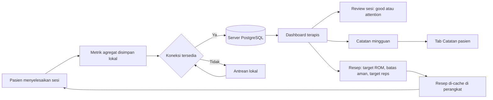
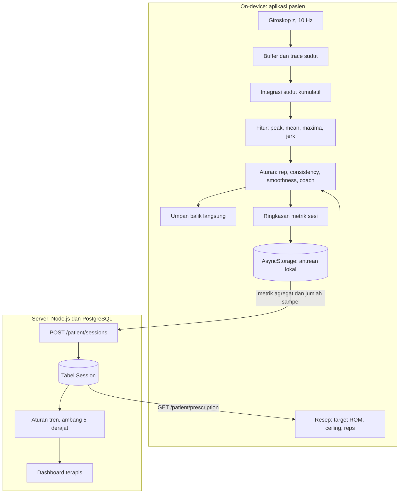
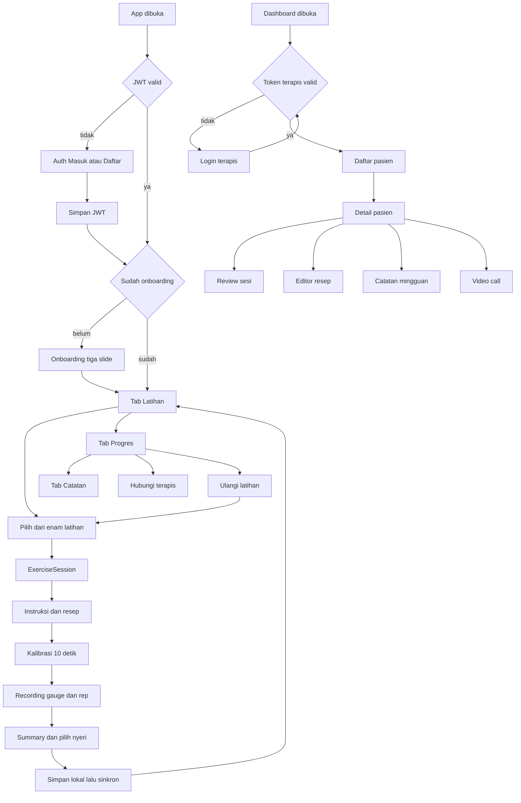

# Deskripsi Proyek: RehabTrack

**Sistem Monitoring Rehabilitasi Pasca-Stroke Berbasis Smartphone dengan Pelacakan Range-of-Motion Menggunakan Gyroscope dan Tele-Supervision Asinkron**

| Item | Keterangan |
|---|---|
| Nama produk | RehabTrack |
| Bidang | Kesehatan digital, rehabilitasi pasca-stroke |
| Platform | Aplikasi mobile pasien (Android/iOS) dan dashboard web terapis |
| Status dokumen | Draf deskripsi untuk GEMASTIK |
| Tanggal | 18 November 2026 |
| Cakupan | MVP Phase 1: pelacakan ROM berbasis giroskop dan tele-supervision asinkron |

Dokumen ini menjelaskan masalah yang diselesaikan, solusi yang diusulkan, implementasi AI, serta desain UX dan wireframe low-fidelity. Dokumen disusun berdasarkan implementasi yang ada di repositori, dokumen produk, spesifikasi teknis internal, dan sumber eksternal yang tercantum pada bagian 6. Penanda `[n]` merujuk literatur atau pedoman eksternal, sedangkan `[I-n]` merujuk dokumen atau bukti internal repositori. Setiap klaim dibedakan secara eksplisit antara fitur yang sudah diimplementasikan, parameter yang masih provisional, dan kapabilitas yang direncanakan.

## Daftar Isi

1. Ringkasan Eksekutif
2. Latar Belakang dan Analisis Masalah
3. Deskripsi Solusi
4. Implementasi AI
5. Desain UX dan Wireframe
6. Rujukan

---

## 1. Ringkasan Eksekutif

Stroke merupakan salah satu beban penyakit utama di Indonesia. Riskesdas 2018 melaporkan prevalensi stroke berdasarkan diagnosis dokter sebesar 10,9 per mil, sedangkan estimasi Global Burden of Disease 2019 memperkirakan sekitar 642.943 insiden baru dan 4.918.487 orang hidup dengan stroke di Indonesia [1][2]. Setelah fase akut, kebutuhan rehabilitasi berlanjut, tetapi akses layanan tidak merata. Pemulihan fungsi lengan bergantung pada latihan berulang yang terukur, sementara terapi lanjutan sering menghadapi batasan kapasitas dan jarak [3][4].

RehabTrack menjawab kesenjangan itu sebagai asisten terapis, bukan pengganti. Aplikasi mobile pasien (Expo/React Native) memandu enam latihan ROM, mengukur gerakan melalui giroskop ponsel, menampilkan gauge sudut dan hitungan repetisi, serta memberi umpan balik audio saat target atau batas aman tercapai. Setiap sesi ditutup dengan ringkasan peak dan average ROM, repetisi, consistency, smoothness, ceiling hits, serta pemilihan tingkat nyeri yang wajib. Dashboard web terapis (React/Vite) menyajikan daftar pasien beserta tren, grafik ROM, log sesi dengan status review, catatan mingguan, editor resep, dan tautan video call. API Express/Prisma/PostgreSQL menghubungkan keduanya, dengan penyimpanan lokal lebih dahulu dan sinkronisasi saat online [I-1].

Nilai utamanya ada pada tiga hal yang saling mengunci: pengukuran ROM yang objektif dengan ponsel, loop resep dan review yang menjaga keputusan klinis pada terapis, dan antarmuka berbahasa Indonesia untuk pengguna dengan literasi teknologi rendah. Pembedanya adalah posisi sebagai alat bantu terapis dengan resep per latihan dan rencana validasi klinis, bukan aplikasi latihan mandiri. Preseden PulihGo dan status kodenya merupakan bukti internal atau analisis pasar yang belum diverifikasi melalui publikasi eksternal [I-2].

Status implementasi MVP Phase 1 sudah mencakup fitur inti berikut: enam latihan, sinkronisasi offline-safe, catatan terapis, review sesi, dan editor resep [I-6]. Sisa pekerjaan mencakup uji perangkat fisik, validasi klinis tiga target ROM provisional, dan perluasan i18n. Target pilot ditetapkan 20 pasien selama 8 minggu dengan minimal 75% kesesuaian ROM terhadap goniometer, minimal 60% adherence, kepuasan minimal 3,5 dari 5, dan minimal satu terapis aktif setiap minggu. Seluruh angka tersebut adalah target pengukuran, bukan hasil yang sudah dicapai.

## 2. Latar Belakang dan Analisis Masalah

### 2.1 Beban stroke dan kesenjangan akses rehabilitasi

Riskesdas 2018 melaporkan prevalensi stroke berdasarkan diagnosis dokter sebesar 10,9 per mil pada penduduk berusia minimal 15 tahun [1]. Estimasi GBD 2019 menempatkan Indonesia pada sekitar 642.943 insiden baru dan 4.918.487 orang yang hidup dengan stroke [2]. Angka Riskesdas adalah survei prevalensi, sedangkan angka GBD adalah estimasi pemodelan insiden dan prevalensi, sehingga keduanya tidak boleh diperlakukan sebagai pengukuran yang sama.

Masalah tidak berhenti pada fase akut di rumah sakit. Survei layanan rehabilitasi stroke di Indonesia menemukan bahwa layanan masih dominan berbasis rumah sakit, dukungan setelah pulang belum seragam, dan kurang dari separuh rumah sakit yang disurvei memiliki pedoman perencanaan pulang [4]. Pedoman nasional juga menekankan perlunya pelayanan stroke terpadu yang mencakup rehabilitasi dan tindak lanjut [3].

Kesenjangan tersebut terlihat pada tiga sisi sekaligus. Pertama, layanan rehabilitasi stroke masih terutama berbasis rumah sakit dan frekuensi terapi yang paling umum dilaporkan adalah dua sampai tiga kali per minggu dengan durasi 30 sampai 60 menit [4]. Kedua, data internal proposal memperkirakan ketimpangan antara jumlah fisioterapis dan kebutuhan layanan, tetapi angka sekitar 26.000 fisioterapis, kebutuhan lebih dari 200.000, sekitar 40 stroke unit, serta biaya Rp500.000 sampai Rp1.000.000 per sesi belum memiliki sumber primer yang cukup kuat di repositori [I-3]. Angka tersebut karena itu diperlakukan sebagai estimasi kerja yang perlu dikonfirmasi, bukan fakta nasional final. Ketiga, perjalanan dan kebutuhan pendamping dapat menjadi hambatan tambahan, terutama bagi pasien dengan keterbatasan mobilitas. Pedoman telerehabilitasi merekomendasikan teknologi jarak jauh sebagai pelengkap layanan tatap muka, dengan perhatian pada kesenjangan digital, keselamatan, dan kemampuan pasien menggunakan teknologi [8].

Hambatan transportasi dan cakupan layanan memperbesar persoalan. Proposal ini tidak mengklaim bahwa BPJS menanggung seluruh rehabilitasi atau bahwa telekonsultasi otomatis menggantikan kunjungan klinis. Klaim yang didukung pedoman adalah bahwa rehabilitasi jarak jauh dapat dipertimbangkan untuk memperluas akses bila dipersonalisasi, dipantau terapis, dan dilengkapi pilihan tatap muka [8]. Berdasarkan sintesis internal, sebagian penyintas dipulangkan ke rumah dengan akses terapi berkelanjutan yang terbatas. Klaim kuantitatif tentang proporsi tersebut ditandai sebagai belum terverifikasi [I-3].

Beban juga bergeser ke keluarga. Pendamping sering harus membantu memposisikan ponsel, mengingatkan jadwal latihan, dan mencatat keluhan pasien. Solusi yang menambah kerumitan operasional, misalnya menuntut perangkat khusus atau pengaturan yang rumit, cenderung ditinggalkan setelah beberapa minggu, terutama ketika tidak ada anggota keluarga yang dapat mendampingi setiap sesi.

### 2.2 Jendela kritis dan bukti ilmiah latihan berulang

Pemulihan pasca-stroke tidak berakhir saat pasien keluar dari rumah sakit. Literatur membedakan fase awal, subakut, dan kronis, dengan sebagian besar pemulihan spontan terjadi lebih awal tetapi kemungkinan perbaikan fungsional tetap bervariasi dan dapat berlanjut pada fase kronis [6]. Karena itu, periode 6 sampai 12 bulan di proposal ini adalah konteks target layanan rumah, bukan batas biologis universal atau jendela pemulihan yang pasti.

Bukti ilmiah mendukung arah intervensi ini dengan batasan penting. Tinjauan Cochrane oleh French et al. (2016) menemukan bukti berkualitas rendah sampai sedang bahwa repetitive task training dapat meningkatkan fungsi anggota gerak, dengan manfaat yang teramati sampai sekitar enam bulan setelah intervensi [5]. Li (2023) menekankan bahwa pemulihan memiliki lintasan individual: prediksi pemulihan spontan lebih dapat dilakukan pada tiga sampai enam bulan pertama, tetapi hasil jangka panjang tidak berhenti pada satu tenggat yang sama untuk semua pasien [6]. Survei layanan Indonesia melaporkan frekuensi yang paling umum adalah dua sampai tiga sesi per minggu [4], sedangkan variasi dosis dalam bukti repetitive task training tidak mendukung penetapan satu ambang universal [5]. Karena itu, target tiga sesi per minggu pada proposal ini adalah hipotesis operasional untuk pilot, bukan ambang universal yang ditetapkan literatur.

Karena itu, solusi yang hanya menampilkan video latihan tidak cukup. Yang dibutuhkan adalah pengukuran yang objektif, umpan balik yang terlihat oleh pasien, dan jalur review yang memungkinkan terapis menyesuaikan target. Ketiga elemen ini menjadi dasar rancangan RehabTrack.

Pengukuran menjadi kunci karena ukuran kinematik dapat melengkapi penilaian klinis. Meta-analisis 2024 menemukan bahwa IMU memiliki validitas konkuren baik sampai sangat baik untuk beberapa gerakan anggota gerak atas, tetapi hasilnya bervariasi menurut jenis gerakan dan perlu digunakan dengan hati-hati [7]. Kerangka konsensus pengukuran gerakan anggota gerak atas juga menekankan pentingnya definisi dan prosedur yang konsisten sebelum perbandingan antar sesi [9]. Karena itu, target 75 persen kesesuaian dengan goniometer adalah target pilot RehabTrack, bukan ambang klinis yang sudah terbukti. Pengukuran yang konsisten tetap dapat membantu terapis membandingkan sesi, selama hasilnya dibaca bersama konteks klinis dan keterbatasan sensor.

### 2.3 Analisis akar masalah

Akar masalah dapat dipetakan menjadi lima kelompok yang saling memperkuat. Tabel berikut merangkum hubungan antara masalah yang diamati, akar penyebab, dan konsekuensinya bagi pasien maupun terapis.

| Masalah yang diamati | Akar penyebab | Konsekuensi |
|---|---|---|
| Latihan rumah tidak terpantau | Rasio fisioterapis terhadap kebutuhan sangat jauh dan waktu per pasien terbatas | Tidak ada koreksi teknik, dosis latihan tidak disesuaikan, kemunduran tidak terdeteksi |
| Program rehabilitasi terputus | Biaya per sesi Rp500.000 sampai Rp1.000.000 dan total program puluhan juta rupiah [I-3] | Frekuensi latihan turun, latihan berhenti sebelum target fungsional tercapai |
| Kehadiran sesi rendah | Friksi transportasi, keterbatasan mobilitas, kebutuhan pendamping | Ketidakhadiran berulang, jadwal tidak konsisten, terapis kehilangan data perkembangan |
| Motivasi menurun | Tidak ada umpan balik objektif, kemajuan hanya dirasakan secara subjektif | Pasien berhenti saat merasa tidak ada perubahan, padahal perbaikan kecil sulit dirasakan tanpa data |
| Data tidak dapat dipakai terapis | Pencatatan manual di spreadsheet atau foto melalui WhatsApp | Riwayat tidak rapi, tren tidak terbaca, keputusan klinis bertumpu pada ingatan |

Pola yang muncul adalah kegagalan loop, bukan kegagalan satu komponen. Pasien berlatih tanpa data, terapis tidak menerima data, dan keputusan berikutnya tidak pernah kembali ke pasien. Intervensi yang hanya menyelesaikan satu bagian, misalnya panduan latihan tanpa pengukuran atau pengukuran tanpa review terapis, tidak menutup loop tersebut.

### 2.4 Lanskap solusi yang ada dan celahnya

Beberapa kategori solusi telah tersedia, tetapi masing-masing memiliki celah untuk konteks Indonesia [I-2]. Tabel berikut membandingkan solusi yang ada dari sisi kekuatan dan keterbatasannya.

| Solusi yang ada | Kekuatan | Celah untuk konteks Indonesia |
|---|---|---|
| Neofect dan perangkat rehabilitasi serupa | Perangkat khusus dengan sensor dan gamifikasi | Harga perangkat tinggi, pengadaan sulit, tidak cocok untuk rumah tangga dengan anggaran terbatas |
| Rehabify, MIRA, Flint Rehab | Program latihan terstruktur dan pelacakan digital | Berbahasa Inggris, alur dan materi tidak disesuaikan dengan praktik klinis lokal |
| Halodoc, Alodokter, SehatQ | Akses konsultasi dan informasi kesehatan | Fokus pada konsultasi dokter umum, bukan pelacakan rehabilitasi motorik |
| Spreadsheet dan WhatsApp | Murah, sudah dikenal, fleksibel | Tidak objektif, tidak ada perhitungan ROM, tidak ada tren yang dapat dibaca cepat |
| PulihGo (GEMASTIK 2026) | Membuktikan giroskop ponsel memadai untuk pelacakan ROM | Berhenti pada aplikasi pasien, belum menempatkan resep dan review terapis sebagai inti |
| RehabTrack (diusulkan) | ROM objektif tanpa perangkat tambahan, resep terapis, dashboard review, offline-first, Bahasa Indonesia | Perlu validasi klinis target ROM dan uji perangkat fisik sebelum pilot |

Dua kesimpulan dapat ditarik. Pertama, hambatan adopsi bukan hanya harga, tetapi juga bahasa, konteks praktik, dan ketiadaan jalur data ke terapis. Kedua, preseden PulihGo menunjukkan bahwa ponsel saja cukup untuk mengukur ROM, sehingga investasi perangkat keras tidak diperlukan pada tahap ini. RehabTrack memposisikan diri sebagai asisten terapis dengan loop resep dan validasi klinis, bukan sebagai pengganti terapis. Aplikasi tidak melakukan diagnosis, tidak mengukur spastisitas, dan bukan alat medis tersertifikasi. Keputusan klinis tetap berada pada terapis melalui resep target ROM, batas aman, dan target repetisi, serta review sesi.

### 2.5 Rumusan masalah dan tujuan terukur

Dari uraian di atas, rumusan masalah proposal ini adalah: bagaimana merancang sistem rehabilitasi pasca-stroke yang memungkinkan pasien melakukan latihan ROM di rumah dengan pengukuran objektif hanya menggunakan ponsel, menjaga terapis tetap berada dalam loop melalui resep dan review asinkron, tetap berfungsi saat koneksi tidak tersedia, dan menggunakan Bahasa Indonesia agar dapat dipakai oleh pasien dengan literasi teknologi rendah, tanpa menambah beban biaya perangkat keras.

Untuk menjawab rumusan tersebut, tujuan pengembangan diarahkan pada empat hal. Pertama, membangun aplikasi pasien dan dashboard terapis yang terhubung melalui satu API dengan enam latihan ROM (rotasi lengan bawah, angkat bahu, tekuk siku, tekuk pergelangan, buka jari, dan tarik resistance band) serta alur sesi terstandar. Kedua, mengukur kesesuaian ROM hasil aplikasi terhadap penilaian goniometer oleh terapis. Ketiga, mengukur adherence dan kepuasan pasien selama program pemantauan. Keempat, memastikan dashboard benar-benar digunakan terapis dalam ritme mingguan. Indikator keberhasilan dirumuskan pada skala pilot sebagai berikut.

| Indikator | Target pilot | Cara pengukuran |
|---|---|---|
| Partisipasi pasien | 20 pasien selama 8 minggu | Rekrutmen dan penyelesaian program |
| Kesesuaian ROM | Minimal 75% kesesuaian dengan goniometer | Perbandingan pengukuran aplikasi dan terapis |
| Adherence latihan | Minimal 60% pasien menyelesaikan minimal 3 sesi per minggu sesuai resep | Log sesi tersinkronisasi |
| Kepuasan pasien | Rata-rata minimal 3,5 dari 5 | Kuesioner akhir program |
| Keterlibatan terapis | Minimal 1 terapis aktif menggunakan dashboard setiap minggu | Log review dan catatan mingguan |

Angka pada tabel tersebut adalah target pengukuran pilot, bukan hasil yang telah dicapai. Capaian sebenarnya akan dilaporkan setelah uji perangkat fisik dan validasi klinis selesai. Dengan batas tersebut, RehabTrack diposisikan sebagai instrumen pemantauan dan alat bantu keputusan terapis pada fase rumah, bukan sebagai pengganti asesmen klinis. Bagian berikutnya membahas solusi yang diusulkan, arsitektur sistem, serta rancangan pengalaman pengguna secara lebih rinci.

---


## 3. Deskripsi Solusi

### 3.1 Gambaran solusi

RehabTrack adalah asisten terapis digital untuk pemulihan pasca-stroke yang dijalankan di ponsel pasien dan browser terapis, bukan pengganti terapis. Pasien melakukan latihan rentang gerak (range of motion, ROM) di rumah dengan panduan aplikasi, sensor gyroscope ponsel mengukur gerakan secara objektif, dan terapis meninjau data serta menetapkan resep latihan secara asinkron dari dashboard web. Keputusan klinis tetap berada di tangan terapis: aplikasi menyediakan pengukuran, struktur latihan, dan kanal tindak lanjut, sedangkan terapis menetapkan target, batas aman, jumlah repetisi, serta menandai sesi yang memerlukan perhatian. Dengan posisi ini, RehabTrack mengisi celah antara pemulangan pasien dan ketersediaan terapi lanjutan tanpa klaim diagnostik.

### 3.2 Menjawab akar masalah secara human-centered

Setiap fitur diturunkan dari akar masalah yang didukung literatur dan audit internal. Estimasi GBD 2019 memperkirakan sekitar 642.943 insiden baru dan 4.918.487 orang hidup dengan stroke di Indonesia [2]. Survei layanan rehabilitasi menunjukkan layanan masih dominan berbasis rumah sakit dan dukungan setelah pulang belum seragam [4]. Angka tenaga, biaya, dan jumlah stroke unit pada tabel berikut tetap diberi label estimasi internal bila belum memiliki sumber primer [I-3].

| Akar masalah | Wujud di lapangan | Fitur RehabTrack | Status |
|---|---|---|---|
| Akses terapi terbatas | Tidak ada jadwal lanjutan setelah pulang | Latihan terpandu di rumah; dashboard untuk memantau banyak pasien secara asinkron | Sudah diimplementasikan |
| Biaya tinggi | Rp500.000 sampai Rp1.000.000 per sesi ditambah transportasi | Tanpa perangkat keras tambahan, hanya ponsel yang sudah dimiliki | Sudah diimplementasikan |
| Tidak ada umpan balik objektif | Latihan rumah dinilai dari cerita pasien | Pengukuran ROM gyroscope, ringkasan sesi, dan grafik tren per latihan | Sudah diimplementasikan |
| Motivasi menurun | Kemajuan tidak terlihat, latihan berhenti | Streak harian, ringkasan harian, grafik ROM, dan catatan mingguan terapis | Sudah diimplementasikan |
| Keselamatan latihan | Pasien berlatih sendiri tanpa batas gerak yang jelas | Batas aman ROM, peringatan audio, pemilihan nyeri wajib | Sudah diimplementasikan |

### 3.3 Dua antarmuka

#### 3.3.1 Aplikasi pasien

Aplikasi pasien dibangun dengan React Native melalui Expo SDK 57. Alurnya pendek karena pengguna utama berusia 45 sampai 70 tahun dengan literasi teknologi rendah sampai sedang.

Pertama, layar autentikasi menyatukan pendaftaran dan masuk dalam satu layar. Pendaftaran meminta nama, email, nomor telepon opsional, dan kata sandi minimal delapan karakter. Setelah berhasil, token JWT disimpan di perangkat.

Kedua, onboarding tiga slide menjelaskan tujuan aplikasi, cara kalibrasi, dan aturan keselamatan bahwa nyeri berarti berhenti. Onboarding hanya muncul sekali setelah login pertama dan dapat diputar ulang dari tab Progres.

Ketiga, navigasi utama memakai tiga tab: Latihan, Progres, dan Catatan. Tab Latihan menampilkan enam latihan berikut.

| Latihan | Target ROM | Status target |
|---|---:|---|
| Rotasi lengan bawah (forearm supination) | 80 derajat | Target awal MVP |
| Angkat bahu ke samping (shoulder abduction) | 90 derajat | Target awal MVP |
| Tekuk siku (elbow flexion) | 150 derajat | Target awal MVP |
| Tekuk pergelangan (wrist flexion) | 60 derajat | Provisional |
| Buka jari (finger extension) | 30 derajat | Provisional |
| Tarik resistance band (resistance band row) | 45 derajat | Provisional |

Setiap kartu latihan menampilkan nama, deskripsi singkat, target ROM, dan tombol mulai. Sebelum sesi dimulai, layar instruksi menampilkan target ROM, batas aman, target repetisi, serta sumber resep (server, cache, atau default). Alur sesi kemudian berjalan dalam lima tahap: instruksi, kalibrasi 10 detik dengan posisi ponsel diam, perekaman dengan pembacaan sudut langsung dan penghitung repetisi, ringkasan sesi, lalu penyimpanan. Perekaman berhenti otomatis saat target repetisi tercapai atau setelah 3 menit. Deteksi repetisi memakai ambang 45 persen target ROM untuk masuk hitungan dan 18 persen untuk menutup satu repetisi, keduanya masih provisional.

Ringkasan sesi menampilkan ROM puncak, ROM rata-rata, repetisi, label konsistensi, skor smoothness, dan jumlah pelanggaran batas aman. Pasien wajib memilih tingkat nyeri sebelum dapat menyimpan: tanpa nyeri, nyeri ringan, atau berhenti karena nyeri. Catatan bebas bersifat opsional.

Tab Progres menampilkan streak, kalender mingguan, ringkasan harian, grafik ROM delapan sesi terakhir, daftar sesi terakhir, dan tombol Hubungi Terapis yang membuka tautan video call eksternal. Tab Catatan menampilkan catatan mingguan dari terapis beserta nomor minggu, tanggal, dan nama terapis.

#### 3.3.2 Dashboard terapis

Dashboard terapis dibangun dengan React dan Vite. Terapis masuk memakai email dan kata sandi, lalu melihat daftar pasien yang menampilkan tanggal sesi terakhir dan indikator tren. Tren dihitung dari selisih ROM puncak sesi terakhir terhadap rata-rata dua sesi sebelumnya pada latihan yang sama, dengan ambang 5 derajat.

Halaman detail pasien memuat statistik ringkas (total sesi, total repetisi, ROM terakhir, jumlah catatan), grafik ROM delapan sesi terakhir dengan pemilih latihan, dan log sesi. Setiap sesi dapat ditandai good atau attention, dan status tersebut tersimpan di server. Terapis juga dapat menulis catatan mingguan yang langsung terlihat di tab Catatan pasien, menyusun resep per latihan (target ROM, batas aman, target repetisi), serta memulai video call melalui tautan Google Meet atau Zoom yang dikonfigurasi. Resep disimpan pada tabel Prescription yang unik per kombinasi pasien dan latihan, sehingga satu pasien memiliki satu rencana aktif untuk setiap latihan.

### 3.4 Loop terapi asinkron

Inti produk adalah loop tertutup yang tidak menuntut kehadiran bersamaan. Pasien berlatih, data agregat tersimpan, terapis meninjau, terapis menyesuaikan resep atau memberi catatan, lalu pasien menerima arahan baru pada sesi berikutnya.



Loop ini asinkron karena terapis tidak mungkin memantau pasien secara real-time, sedangkan pedoman klinis menyatakan telerehabilitasi dapat dipakai untuk melengkapi rehabilitasi tatap muka bila dipersonalisasi, dipantau terapis, dan disertai akses review langsung bila diperlukan [8]. Dengan demikian, beban terapis diusulkan berubah dari kunjungan rutin menjadi peninjauan data yang dapat dilakukan dalam waktu singkat untuk banyak pasien. Efek terhadap biaya, jumlah kunjungan, dan hasil klinis tetap menjadi hipotesis yang harus diuji dalam pilot.

### 3.5 Keselamatan dan etika

Keselamatan adalah bagian dari alur utama. Batas aman ROM diambil dari resep terapis dan divalidasi server agar tidak lebih kecil dari target ROM. Saat sudut melewati batas aman, aplikasi menampilkan spanduk peringatan dan memutar nada peringatan berulang. Nada ini adalah peringatan, bukan hadiah, sehingga tidak mendorong pasien melewati batas. Nada capaian target dibunyikan sekali per sesi.

Nyeri diperlakukan sebagai sinyal berhenti. Pilihan berhenti karena nyeri tercatat pada sesi dan tetap dihitung sebagai latihan untuk streak. Keputusan ini disengaja: yang dihargai adalah kehadiran berlatih, bukan jumlah repetisi atau besarnya sudut, sehingga pasien tidak merasa dihukum karena berhenti saat nyeri. Aplikasi tidak memakai leaderboard, peringkat antarpasien, atau gamifikasi kompetitif.

Antarmuka memakai Bahasa Indonesia sebagai bahasa utama, tombol besar dengan target sentuh minimal 44 kali 44 poin, teks minimal 14 piksel, dan mode terang sebagai default dengan opsi tema gelap. Ukuran 44 piksel adalah target desain internal yang lebih longgar daripada minimum WCAG 2.2 AA sebesar 24 kali 24 CSS pixel dan sejalan dengan kriteria enhanced 44 kali 44 pada level AAA [10]. Aplikasi juga tidak membuat klaim diagnostik dan diposisikan sebagai alat edukasi dan pemantauan, bukan perangkat medis bersertifikat.

### 3.6 Offline-first dan keandalan

Rehabilitasi rumah sering terjadi di jaringan yang tidak stabil. Karena itu sesi selalu disimpan ke penyimpanan lokal terlebih dahulu, dengan penanda pending, sebelum ada upaya unggah. Jika unggahan gagal, sesi tetap tersimpan dan ditampilkan sebagai akan disinkronkan nanti. Sesi pending dicoba ulang saat aplikasi kembali aktif dan pada sesi terautentikasi berikutnya. Jika server mengembalikan 401 saat sinkronisasi, token dibersihkan dan pengguna diarahkan kembali ke layar masuk.

Resolusi resep juga dibuat tahan gangguan. Klien mencoba mengambil resep dari server dengan batas waktu 4 detik, lalu memakai cache terakhir, lalu memakai nilai default bawaan. Urutan ini memastikan sesi tidak pernah terblokir oleh jaringan. Data mentah gyroscope tidak diunggah. Hanya metrik agregat yang dikirim, yaitu ROM puncak, ROM rata-rata, repetisi, konsistensi, nyeri, smoothness, pelanggaran batas aman, sumber resep, catatan, dan jumlah sampel gyroscope.

### 3.7 Keunikan dan pembeda

RehabTrack bukan aplikasi kebugaran umum dan bukan telemedicine konsultasi dokter. Pembedanya adalah kombinasi pengukuran ROM tanpa perangkat keras tambahan, loop resep dan review yang melekat pada praktik fisioterapi, serta kerja offline untuk kondisi jaringan Indonesia. Bukti eksternal mendukung penggunaan teknologi gerak dan telerehabilitasi sebagai pelengkap, tetapi tidak membuktikan bahwa RehabTrack sendiri menurunkan biaya atau menggantikan terapi tatap muka [7][8].

| Aspek | RehabTrack | Neofect | Rehabify, MIRA, Flint Rehab | Halodoc, Alodokter, SehatQ | Spreadsheet dan WhatsApp | PulihGo |
|---|---|---|---|---|---|---|
| Perangkat keras | Ponsel Android atau iOS dengan gyroscope | Perangkat rehabilitasi khusus ditambah ponsel | Sebagian memerlukan perangkat khusus | Ponsel | Ponsel | Ponsel dengan gyroscope |
| Bahasa Indonesia | Ya | Tidak | Tidak, antarmuka berbahasa Inggris | Ya | Ya | Ya, produk lokal |
| Fokus rehabilitasi ROM | Ya, enam latihan dengan pengukuran sensor | Ya, tetapi bergantung perangkat | Ya, tidak dirancang untuk Indonesia | Tidak, berfokus konsultasi dokter | Tidak, pencatatan manual | Ya, berbasis gyroscope |
| Loop resep terapis | Ya: resep, review sesi, catatan mingguan | Belum terverifikasi | Belum terverifikasi | Tidak | Tidak | Belum terverifikasi |
| Offline | Ya: simpan lokal lalu sinkronisasi | Belum terverifikasi | Belum terverifikasi | Tidak | Sebagian, bergantung aplikasi | Belum terverifikasi |
| Biaya | Freemium dan lisensi institusi (rencana) | Langganan dan perangkat berbayar | Langganan, harga belum terverifikasi | Per konsultasi | Gratis | Belum publik |

Catatan: data pesaing disarikan dari analisis pasar pada dokumen validasi masalah dan perlu diverifikasi ulang. Sel yang belum terverifikasi ditandai eksplisit.

### 3.8 Model keberlanjutan

Model awal adalah freemium untuk pasien, dengan fitur inti latihan dan pencatatan tetap gratis. Pendapatan utama diarahkan pada lisensi B2B dan B2G untuk rumah sakit, klinik, dan program rehabilitasi, di mana institusi membayar per terapis atau per paket pasien. Model ini adalah hipotesis bisnis yang perlu diuji, bukan klaim bahwa BPJS telah menyetujui reimbursement atau lisensi RehabTrack. Pada tahap ini belum ada kemitraan yang ditandatangani dengan rumah sakit, klinik, BPJS, maupun penyedia telemedicine.

### 3.9 Status implementasi

Status berikut disusun dari dokumentasi engineering dan kondisi kode, dengan pembedaan tegas antara berjalan, provisional, dan direncanakan.

| Komponen | Status | Keterangan |
|---|---|---|
| Enam latihan dan alur sesi | Sudah diimplementasikan | Instruksi, kalibrasi 10 detik, perekaman, ringkasan, penyimpanan |
| Resep per latihan | Sudah diimplementasikan | Tersimpan di tabel Prescription, unik per pasien dan latihan |
| Review sesi good atau attention | Sudah diimplementasikan | Persisten di server |
| Catatan mingguan terapis | Sudah diimplementasikan | Terlihat di tab Catatan pasien |
| Sinkronisasi offline | Sudah diimplementasikan | Simpan lokal lebih dulu, retry saat aplikasi aktif |
| Internasionalisasi penuh | Sebagian | Modul i18n tersedia, cakupan belum 100 persen |
| Uji perangkat fisik tercatat | Belum | Prosedur manual ada, hasil uji belum terdokumentasi |
| Validasi klinis target ROM tambahan | Belum | Tiga target masih provisional |
| Fitur kamera dan audio Phase 2 | Direncanakan | Belum diimplementasikan |

Secara keseluruhan, fitur inti MVP Phase 1 sudah tersambung. Sisa pekerjaan terbesar adalah uji perangkat fisik, penuntasan lokalisasi, dan validasi klinis target ROM provisional.

### 3.10 Dampak yang diharapkan

Dampak di bawah ini adalah target pengukuran pilot, bukan hasil yang sudah dicapai. Pilot direncanakan melibatkan 20 pasien selama 8 minggu dengan setidaknya satu terapis mitra.

| Indikator | Target | Cara ukur |
|---|---|---|
| Kesesuaian ROM aplikasi dengan goniometer | Minimal 75 persen | Perbandingan pengukuran aplikasi dan terapis pada sesi yang sama |
| Kepatuhan latihan | Minimal 60 persen | Proporsi pasien yang menyelesaikan minimal tiga sesi per minggu sesuai resep |
| Kepuasan pasien | Minimal 3,5 dari 5 | Survei akhir pilot |
| Kunjungan fisik | Menurun dibanding pola sebelum pilot | Jumlah kunjungan per pasien per bulan |
| Biaya per pasien | Lebih rendah dari rehabilitasi konvensional | Perbandingan biaya sesi dan transportasi |

Jika target ini tercapai, RehabTrack dapat menurunkan biaya dan beban perjalanan tanpa memutus hubungan pasien dengan terapis. Angka di atas tetap hipotesis yang harus dibuktikan melalui pilot, bukan capaian saat ini.

---


## 4. Implementasi AI

Bagian ini menjelaskan komponen AI pada RehabTrack, batas kemampuannya, dan arah pengembangannya. Perlu ditegaskan sejak awal: MVP tidak menjalankan model machine learning terlatih dan tidak memiliki dataset latih. Inti AI pada MVP adalah analitik deret waktu dan inferensi berbasis pengetahuan (knowledge-based atau rule-based) di perangkat. Pendekatan ini dipilih karena dapat dijelaskan, berjalan on-device dan offline, berlatensi rendah, tidak menuntut dataset besar, dan sesuai dengan kebutuhan klinis yang tidak boleh menjadi kotak hitam. Penggunaan IMU untuk mengukur ROM didukung oleh tinjauan validitas, tetapi tinjauan tersebut juga melaporkan variasi menurut jenis gerakan, sehingga validasi lokal tetap wajib [7].

### 4.1 Posisi dan alasan pendekatan

Giroskop membaca kecepatan sudut sumbu z setiap 100 milidetik, menghasilkan deret waktu 10 Hz. Dari deret itu aplikasi mengestimasi rentang gerak, konsistensi, kehalusan, dan repetisi secara deterministik. Tidak ada bobot jaringan saraf, inferensi probabilistik yang tidak transparan, atau data pasien yang dikirim ke penyedia model eksternal.

Empat alasan menopang pilihan ini. Pertama, explainability: setiap label dapat dilacak ke ambang dan rumus tertentu sehingga terapis dapat mempertanyakan atau mengabaikannya. Kedua, operasi on-device dan offline: latihan tetap berfungsi di daerah dengan konektivitas terbatas. Ketiga, latensi rendah: umpan balik dan peringatan muncul dalam siklus pembacaan sensor. Keempat, tidak butuh dataset besar: aturan biomekanika dan resep terapis dapat dipakai sejak hari pertama.

Personalisasi tidak dilakukan melalui pembelajaran mesin, melainkan melalui pengetahuan terapis yang dipindahkan ke parameter. Target ROM, batas aman, dan target repetisi berasal dari resep lalu dibaca inferensi di perangkat. Computer vision dan audio direncanakan pada Phase 2, sedangkan model prediktif menyusul setelah data pilot. Pembelajaran mesin akan melengkapi, bukan menggantikan, lapisan aturan yang dapat diaudit.

### 4.2 Arsitektur pipeline MVP

Pipeline berjalan satu arah dari sensor ke dashboard dengan satu batas jaringan. Semua pengolahan sinyal dan inferensi berada di perangkat; server menyimpan metrik agregat, menghitung tren, dan menyajikannya ke terapis.



Pemrosesan bersifat streaming: setiap bacaan langsung memperbarui sudut, puncak, dan status repetisi. Memori tumbuh linear karena trace disimpan untuk konsistensi dan smoothness, tetapi tetap kecil pada 10 Hz dan batas sesi tiga menit. Sebelum unggahan, hanya ROM puncak, ROM rata-rata, jumlah repetisi, konsistensi, smoothness, pelanggaran batas aman, nyeri, dan jumlah sampel yang menyeberang ke server. Deret giroskop mentah tidak ikut.

Metrik per repetisi, yaitu ekskursi, durasi, dan smoothness, dihitung dan disimpan di perangkat. Skema server belum memiliki kolomnya, sehingga metrik ini tidak dipersistenkan di server. Ini batasan yang disengaja untuk menjaga ukuran data dan privasi.

### 4.3 Komponen dan dasar matematis

| Komponen | Input | Metode | Output | Status |
|---|---|---|---|---|
| Integrasi ROM | Bacaan z (rad/s), 10 Hz | Integrasi rektangular, nilai absolut, maksimum dan rata-rata | peakRom, avgRom | Ada |
| Konsistensi | Trace sudut | Local maxima, 10 puncak terbesar, relative standard deviation | high, medium, low | Ada |
| Smoothness | Trace per segmen | Third difference (jerk), RMS terpusat, pemetaan 0 sampai 1 | Skor 0 sampai 1 | Ada, skala provisional |
| Deteksi repetisi | Sudut dan target resep | Hysteresis masuk 45 persen, keluar 18 persen, batas minimum | Jumlah repetisi, indeks akhir | Ada, rasio provisional |
| Ambang sadar resep | Resep terapis | Target ROM, batas aman, reps, fallback cache dan default | Parameter inferensi per pasien | Ada |
| Coach insight | Sesi harian pasien | Urutan aturan: nyeri, smoothness, ROM relatif target | Judul dan pesan | Ada |
| Effort indicator | Sesi harian pasien | Aturan sama, dipetakan ke label | Label dan persentase tampilan | Ada, indikator UI |
| Tren pasien | Tiga sesi terakhir | Puncak terakhir vs rata-rata dua sesi sebelumnya | Naik, stabil, turun | Ada di server |

Integrasi ROM mengakumulasikan kecepatan sudut; nilai absolut kumulatif dipakai untuk puncak dan rata-rata, sedangkan trace bertanda dipakai untuk ekskursi per repetisi.

```text
deltaDeg = z * dt * (180 / pi), dengan dt = 0,1 detik
angle = angle + deltaDeg
peakRom = max(|angle|)
avgRom = mean(|angle|)
```

Titik nol adalah posisi ponsel saat perekaman dimulai, sehingga peakRom mengukur perpindahan dari posisi awal, bukan sudut anatomis absolut. Perbandingan dengan goniometer perlu memperhitungkan konvensi ini. Ekskursi per repetisi memakai selisih maksimum dan minimum segmen pada trace bertanda.

Konsistensi mengambil sepuluh local maxima terbesar, yaitu titik yang tidak lebih kecil dari kedua tetangganya, lalu menghitung relative standard deviation. Bila tidak ada local maxima, nilai maksimum trace dipakai. Ambang di bawah 10 persen adalah high, di bawah 25 persen medium, dan selain itu low.

```text
rsd = stdev(puncak terpilih) / mean(puncak terpilih)
high   jika rsd < 0,10
medium jika rsd < 0,25
low    selainnya
```

Smoothness memakai jerk, turunan ketiga posisi sudut, yang dipusatkan lalu dihitung root mean square-nya.

```text
jerk[i] = a[i] - 3*a[i-1] + 3*a[i-2] - a[i-3]
rms = sqrt(mean((jerk - mean(jerk))^2))
smoothness = 1 / (1 + rms / 5)
```

Skala 5 provisional dan belum divalidasi terhadap penilaian terapis. Segmen dengan kurang dari empat sampel mengembalikan skor 1, sehingga sesi sangat pendek perlu ditafsirkan hati-hati.

Deteksi repetisi memakai hysteresis: repetisi dimulai saat sudut mencapai 45 persen target ROM dengan batas minimum 5 derajat, dan dihitung saat turun ke 18 persen target dengan batas minimum 2 derajat. Setelah dihitung, status masuk direset. Penghitung berhenti pada target repetisi resep dan sesi berhenti otomatis saat target tercapai. Rasio dan batas minimum ini masih provisional.

Ambang sadar resep membuat inferensi menyesuaikan pasien. Resolusi resep mencoba server lebih dahulu dengan batas waktu empat detik, lalu cache lokal, lalu default latihan. Respons divalidasi agar ketiga target berupa angka positif dan masuk akal. Pasien dengan target lebih rendah atau batas aman lebih ketat memakai ambang deteksi dan peringatan berbeda tanpa mengubah kode. Ini personalisasi berbasis pengetahuan, bukan pembelajaran mesin.

Coach insight dan effort indicator berjalan di perangkat dari sesi harian. Urutannya: nyeri yang membuat latihan berhenti, nyeri ringan, rata-rata smoothness di bawah 0,6, ROM terbaik di bawah 75 persen target, lalu sesi optimal. Effort indicator memetakan kondisi yang sama ke label waktu istirahat, lebih pelan, atau kecepatan aman, dengan persentase tampilan tetap. Persentase itu representasi antarmuka, bukan pengukuran beban fisiologis.

Di server, tren dihitung tanpa model: ROM puncak sesi terakhir dibandingkan dengan rata-rata hingga dua sesi sebelumnya pada latihan yang sama; selisih minimal 5 derajat diberi simbol naik atau turun.

### 4.4 Bagaimana AI membantu terapis

Nilai sistem adalah menyusun perhatian, bukan menggantikan penilaian. Dashboard menampilkan tanggal sesi terakhir dan indikator tren; pasien dengan tren turun ditandai perlu perhatian dan jumlahnya diringkas. Terapis memulai dari data yang berubah paling tajam.

Halaman pasien menyajikan grafik ROM delapan sesi terakhir, log sesi, total sesi, dan total repetisi. Setiap sesi dapat ditandai good atau attention dan statusnya tersimpan di server. Catatan mingguan tersimpan dengan nomor minggu dan terlihat oleh pasien. Metrik agregat, konsistensi, smoothness, pelanggaran batas aman, dan nyeri membantu terapis menilai apakah penurunan ROM disertai nyeri atau gerakan yang makin tidak halus.

Setiap sinyal dapat ditelusuri, misalnya sesi ditandai perlu perhatian karena ROM turun lebih dari 5 derajat. Tidak ada skor gabungan yang tidak dapat diurai. Dashboard tidak menetapkan diagnosis atau mengambil keputusan terapi; keputusan akhir tetap pada terapis.

### 4.5 Phase 2: persepsi multimodal (direncanakan)

Bagian ini adalah rencana. Belum ada kode computer vision atau analisis audio. Dependensi telah disetujui pada spesifikasi teknis, tetapi persetujuan dependensi bukan klaim fitur berjalan. `expo-audio` saat ini hanya memutar isyarat target dan peringatan batas aman, bukan menganalisis suara.

Deteksi asimetri wajah direncanakan memakai `expo-camera` dan `@mediapipe/tasks-vision` atau pembungkus React Native setara. Pasien diminta tersenyum atau mengucapkan suara tertentu. Sistem menghitung jarak pasangan landmark kiri dan kanan terhadap garis tengah wajah, lalu menormalkannya menjadi skor simetri 0 sampai 1 sebagai sinyal pelengkap, bukan diagnosis. Pemrosesan on-device dan frame mentah tidak diunggah.

Pemeriksaan kejelasan bicara direncanakan memakai rekaman sepuluh detik frasa standar, ekstraksi MFCC, dan inferensi on-device dengan TensorFlow.js atau runtime lebih ringan. Keluarannya skor kejelasan atau risiko disartria sebagai sinyal tambahan. Karena audio lebih sensitif, perekaman memerlukan persetujuan eksplisit dan rekaman mentah tidak diunggah.

Target validasi Phase 2, yang dibaca sebagai target dan bukan hasil, adalah kesesuaian minimal 75 persen dengan penilaian klinis dan pengujian pada minimal 20 pasien dengan status asimetri yang diketahui. Angka tersebut berasal dari rencana internal dan perlu ditetapkan bersama terapis sebelum pendaftaran pilot [I-4].

### 4.6 Predictive learning (direncanakan)

Lapisan prediktif belum diimplementasikan. Rencananya deret sesi per pasien, yang mencakup ROM, repetisi, nyeri, dan kehadiran, dipakai untuk memperkirakan risiko penurunan kepatuhan atau plateau, menandai pasien berisiko, dan mengusulkan penyesuaian target kepada terapis.

Komponen ini ditahan sampai data pilot tersedia. Tanpa data longitudinal yang cukup, model hanya menghasilkan pola yang tidak dapat divalidasi. Fase ini bergantung pada data pilot 20 pasien selama 8 minggu, dan rekomendasi model tetap diperlakukan sebagai saran untuk ditinjau terapis.

### 4.7 Privasi, etika, dan batasan

Deret giroskop mentah tidak pernah diunggah. Server hanya menyimpan metrik agregat dan jumlah sampel, bukan deret waktu yang dapat direkonstruksi menjadi pola gerakan detail. Metrik per repetisi tetap di perangkat. Untuk Phase 2, frame kamera dan rekaman audio diproses di perangkat, dengan persetujuan eksplisit sebelum perekaman audio.

Sistem ini bukan alat diagnostik dan tidak membuat klaim medis. Aplikasi tidak mendeteksi stroke, tidak mengukur spastisitas, dan tidak menggantikan pemeriksaan fisik. Label seperti konsistensi rendah atau perlu perhatian adalah sinyal untuk ditinjau, bukan kesimpulan klinis.

Batasan teknis perlu dinyatakan terbuka. Integrasi giroskop rentan drift karena bias sensor terakumulasi, terutama pada sesi panjang. Kalibrasi MVP hanya hitung mundur sepuluh detik agar ponsel diam, tanpa estimasi bias atau koreksi offset eksplisit. Orientasi dan posisi ponsel yang berbeda antar sesi dapat menggeser titik nol. Ambang repetisi, skala smoothness, dan tiga target latihan tambahan masih provisional. Data yang ada belum cukup untuk menilai bias terhadap usia, keparahan, atau keterampilan penggunaan ponsel.

Kalibrasi parameter dan validasi klinis tetap diperlukan sebelum klaim kinerja apa pun, dan keputusan akhir selalu pada terapis. MVP belum sepenuhnya patuh HIPAA atau GDPR; enkripsi at-rest, audit log, dan persetujuan formal direncanakan pada Phase 3.

### 4.8 Evaluasi dan validasi (rencana)

Evaluasi berikut adalah rencana, bukan hasil. Rancangan utamanya pilot 20 pasien selama 8 minggu.

| Aspek | Metode | Target atau luaran | Status |
|---|---|---|---|
| Kesesuaian ROM | ROM aplikasi vs goniometer terapis | Minimal 75 persen kesesuaian | Rencana |
| Konsistensi repetisi | Selisih rep aplikasi vs hitungan terapis | Selisih kecil, tanpa hitungan ganda | Rencana |
| Korelasi smoothness | Korelasi skor smoothness dengan penilaian terapis | Korelasi positif yang signifikan | Rencana, eksploratif |
| Kepatuhan latihan | Log sesi mingguan | 60 persen pasien, 3 sesi per minggu | Rencana |
| Kepuasan pasien | Kuesioner pasca-pilot | Minimal 3,5 dari 5 | Rencana |

Analisis ROM memakai perbandingan berpasangan pada latihan yang sama dengan toleransi sudut yang disepakati sebelum pilot. Korelasi smoothness bersifat eksploratif karena skala jerk belum memiliki rujukan klinis baku. Bila ada deviasi sistematis, parameter akan disetel sebelum klaim publikasi.

### 4.9 Peta jalan riset

1. MVP rule-based, sudah berjalan: integrasi ROM, konsistensi, smoothness, deteksi repetisi, ambang sadar resep, coach insight, effort indicator, dan tren pasien.
2. Kalibrasi parameter dengan data pilot: rasio repetisi, skala smoothness, batas minimum, dan target latihan berdasarkan penilaian terapis.
3. Model prediktif: deret sesi longitudinal untuk memperkirakan risiko penurunan kepatuhan atau plateau setelah data pilot cukup.
4. Multimodal: computer vision asimetri wajah dan audio disartria on-device, persetujuan eksplisit, validasi minimal 75 persen pada minimal 20 pasien.
5. Coaching real-time Phase 3: sinyal multimodal yang telah divalidasi untuk umpan balik langsung, dengan optimasi model on-device untuk latensi.

Urutan ini membangun kredibilitas dari yang paling dapat diverifikasi. Aturan transparan menjadi fondasi, data pilot menjadi bukti kalibrasi, dan pembelajaran mesin ditambahkan hanya ketika datanya cukup. Terapis dibantu data yang dapat dijelaskan, bukan digantikan kotak hitam.

---


## 5. Desain UX dan Wireframe

Bagian ini menerjemahkan persona pada PRD bagian 3 dan fitur inti pada bagian 4 menjadi keputusan desain yang dapat dieksekusi [I-5]. Isinya mencakup prinsip human-centered, sistem visual ringkas, peta navigasi, dua belas wireframe low-fidelity, pertimbangan aksesibilitas dan keselamatan, rencana pengujian, serta batas lingkup yang disengaja. Wireframe di sini bukan desain final dan bukan hasil usability testing. Fungsinya mengunci struktur layar, hierarki aksi, dan state penting sebelum pekerjaan visual dan implementasi rinci.

### 5.1 Prinsip desain human-centered

Pengguna utama adalah penyintas stroke berusia 45 sampai 70 tahun, 3 sampai 12 bulan pasca-stroke, dengan kelemahan pada satu sisi tubuh. Sebagian memakai satu tangan secara dominan, sebagian memiliki tremor halus, dan literasi teknologi umumnya rendah sampai sedang. Pengguna kedua adalah terapis yang menangani 10 sampai 30 pasien dengan waktu terbatas per pasien. Kedua kelompok menuntut disiplin desain yang berbeda, tetapi berbagi satu syarat: informasi harus dapat dipercaya tanpa penjelasan tambahan.

| Kendala pengguna | Implikasi desain |
|---|---|
| Penglihatan berkurang, presbiopi | Teks pasien minimal 16 px, judul 24 px, kontras teks ke latar ditargetkan memenuhi WCAG AA |
| Satu tangan dan tremor | Target sentuh minimal 44 px, tombol utama 48 sampai 52 px, aksi utama di jangkauan jempol |
| Literasi teknologi rendah | Satu aksi utama per layar, label teks eksplisit, tanpa gestur tersembunyi |
| Bahasa dan istilah klinis | Seluruh teks Bahasa Indonesia, sapaan "Anda", istilah teknis diberi penjelasan singkat |
| Terapis sibuk | Dashboard padat tetapi dapat dipindai, status memakai teks dan warna sekaligus |
| Nyeri dan kecemasan | Nada menyemangati, tidak menghakimi, tidak ada skor atau kompetisi |

Keputusan turunan dari tabel tersebut konsisten di seluruh layar. Setiap layar pasien memiliki satu tombol utama berwarna teal atau oranye; tombol lain diturunkan menjadi teks sekunder. Bahasa tidak pernah menyalahkan pengguna. Contoh yang dipakai adalah "Yuk lanjutkan latihan hari ini" dan bukan "Anda belum berlatih tiga hari". Semua sapaan memakai "Anda" karena kelompok usia ini menghargai bentuk formal. Gamifikasi yang merendahkan, seperti lencana, papan peringkat, atau maskot, tidak dipakai; umpan balik positif berasal dari data kemajuan yang nyata. Hari beruntun ditampilkan sebagai indikator kebiasaan, bukan kompetisi, dan tidak ada peringkat antarpasien.

### 5.2 Sistem visual ringkas

Palet pasien memakai teal sebagai warna tindakan dan oranye hangat sebagai penekanan aksi paling penting pada satu layar. Palet dashboard terapis memakai biru yang lebih netral agar terasa profesional dan tidak bersaing dengan warna status pasien.

| Peran | Pasien | Dashboard terapis |
|---|---|---|
| Primer | Teal `#0F9E75` | Blue `#185FA5` |
| Primer gelap | Deep teal `#085041` | Biru tua (turunan dari biru primer) |
| Aksen | Warm orange `#D85A30` | Oranye `#D85A30` |
| Sukses | `#639922` | `#3B6D11` |
| Peringatan | `#BA7517` | `#BA7517` |
| Bahaya | `#A32D2D` | Muted `#993D1D` |
| Latar | `#F7F6F2` | `#F1EFE8` |
| Permukaan | `#FFFFFF` | `#FFFFFF` |
| Teks utama | `#2C2C2A` | `#2C2C2A` |
| Teks sekunder | `#5F5E5A` | `#888780` |
| Garis | `#D3D1C7` | `#D3D1C7` |

Tipografi memakai font sistem agar konsisten dengan kebiasaan perangkat dan tidak menambah unduhan. Aplikasi pasien memakai judul layar 24 px semibold, isi 16 sampai 17 px regular, label tombol 16 px semibold, dan angka besar 32 sampai 40 px bold. Dashboard memakai judul halaman 20 px medium, isi tabel 14 px, dan label grafik 12 px. Tidak ada teks di bawah 14 px, dan teks pasien tidak pernah di bawah 16 px. Jarak baris 1.5 sampai 1.6.

Spacing memakai basis 8 px dengan kelipatan 8, 16, 24, dan 32. Padding horizontal layar pasien minimal 16 px, padding kartu 16 px, dan jarak antar kartu 12 px. Sudut kartu 12 px dan tombol 8 px sampai 12 px; sudut tajam dihindari karena terasa klinis. Tombol pasien setinggi 48 sampai 52 px, sedangkan baris tabel dashboard minimal 48 px agar mudah dipindai. Satu aturan warna bersifat mutlak: merah tidak dipakai sebagai latar bidang besar. Merah hanya muncul sebagai titik, teks kecil, atau garis tepi tipis, sehingga aplikasi tidak terasa mengancam bagi pasien yang sedang pulih.

Catatan implementasi: token warna pada `ThemeContext` sudah sesuai palet di atas, tetapi beberapa layar lama masih menyimpan nilai hardcoded yang sedikit berbeda. Konsolidasi ke token tema menjadi pekerjaan integrasi, bukan perubahan arah desain.

### 5.3 Peta alur navigasi

Alur pasien dimulai dari pemeriksaan token, melewati autentikasi dan onboarding, lalu masuk ke tiga tab. Alur terapis dimulai dari login dan berakhir pada detail pasien dengan empat aksi klinis.



### 5.4 Wireframe low-fidelity

Wireframe berikut memakai mode terang, karena mode terang adalah default untuk validasi. Mode gelap tersedia sebagai opsi di aplikasi, tetapi tidak menjadi fokus validasi klinis dan seluruh gambar di bawah menampilkan versi terang. Setiap wireframe disertai penjelasan singkat mengenai yang dilihat pengguna, aksi utama, state penting, dan alasan keputusan.

#### a. Auth (Masuk dan Daftar)

```text
+----------------------------------------------------------+
|  [RT]  RehabTrack                                        |
|                                                          |
|  Latihan lebih terarah di rumah                          |
|  Pantau gerakan Anda bersama terapis.                    |
|                                                          |
|  [   Masuk   ]  [   Daftar   ]                           |
|                                                          |
|  Nama lengkap                                            |
|  [____________________________________________________]  |
|  Email                                                   |
|  [____________________________________________________]  |
|  Kata sandi                                              |
|  [____________________________________________________]  |
|  Mohon lengkapi data yang diperlukan.                    |
|                                                          |
|  [                    Masuk                        ]     |
+----------------------------------------------------------+
```

Yang dilihat: logo, janji produk satu baris, pengalih Masuk dan Daftar, lalu kolom sesuai mode. Aksi utama adalah tombol teal selebar layar. State penting: tombol berubah menjadi "Memproses..." dan nonaktif saat memuat, pesan galat tampil di atas tombol tanpa menutupi kolom, dan kolom dikosongkan saat mode berganti. Alasan: satu layar untuk dua peran mengurangi langkah bagi pengguna baru, sementara pesan galat yang spesifik menghindari kebingungan.

#### b. Onboarding (slide 1 dan indikator)

```text
+----------------------------------------------------------+
|  RehabTrack                                              |
|                                                          |
|  Latihan pemulihan stroke                                |
|                                                          |
|  RehabTrack membantu Anda berlatih gerakan di rumah.     |
|  Tempelkan ponsel di lengan yang terdampak, lalu ikuti   |
|  gerakan pada layar.                                     |
|                                                          |
|                    ( )  (o)  ( )                         |
|                                                          |
|  [                Lanjut                           ]     |
+----------------------------------------------------------+
```

Yang dilihat: satu ide per slide dengan indikator tiga titik. Aksi utama adalah "Lanjut", yang berubah menjadi "Mulai berlatih" pada slide terakhir. State: tidak ada loading dan tidak ada jaringan; slide dapat diputar ulang dari tombol "?" di tab Progres. Alasan: tiga slide sudah cukup untuk tujuan, kalibrasi, dan aturan nyeri, sehingga onboarding tidak menjadi penghalang sebelum latihan pertama.

#### c. Tab Latihan (daftar enam latihan)

```text
+----------------------------------------------------------+
|  [RT] RehabTrack                                         |
|  Selamat pagi                                            |
|  Pilih latihan                                           |
|  Pilih satu latihan untuk memulai sesi Anda hari ini.    |
|                                                          |
|  Latihan rutin setiap hari mempercepat pemulihan.        |
|                                                          |
|  +----------------------------------------------------+  |
|  |  Rotasi lengan bawah                    80 derajat  |  |
|  |  Putar pergelangan perlahan ke dua arah.           |  |
|  |                                        [ Mulai ]   |  |
|  +----------------------------------------------------+  |
|  |  Angkat bahu ke samping                 90 derajat  |  |
|  |  Tekuk siku                            150 derajat  |  |
|  |  Tekuk pergelangan                      60 derajat  |  |
|  |  Buka jari                              30 derajat  |  |
|  |  Tarik resistance band                  45 derajat  |  |
|                                                          |
|  [ Latihan ]   [ Progres ]   [ Catatan ]                 |
+----------------------------------------------------------+
```

Yang dilihat: sapaan sesuai jam, satu kalimat pengingat, dan enam kartu latihan dengan target ROM. Aksi utama adalah mengetuk kartu mana pun, bukan tombol kecil terpisah. State: daftar bersifat lokal sehingga tetap tampil offline; kartu yang disentuh memberi umpan balik tekan berupa perubahan opasitas. Alasan: kartu penuh yang dapat diketuk lebih forgiving bagi tangan dengan tremor dibanding tombol kecil di sudut kartu.

#### d. ExerciseSession: Instruksi dan resep

```text
+----------------------------------------------------------+
|  o  Rotasi lengan bawah                                  |
+----------------------------------------------------------+
|  CARA LATIHAN                                            |
|  Pegang ponsel dengan telapak menghadap ke bawah.        |
|  Putar pergelangan secara perlahan ke dua arah.          |
|                                                          |
|  Target ROM      Batas aman      Target rep              |
|     80 derajat      90 derajat        10                 |
|  Dari terapis                                            |
|                                                          |
|  Hentikan segera jika terasa sakit atau tidak nyaman.    |
|                                                          |
|  [                Mulai Kalibrasi                   ]    |
+----------------------------------------------------------+
```

Yang dilihat: nama latihan, instruksi singkat, tiga angka resep, sumber resep, dan catatan keselamatan. Aksi utama adalah "Mulai Kalibrasi". State: saat resep sedang dimuat, label menampilkan "(memuat...)"; bila gagal, nilai default dipakai dan sumbernya ditulis "Default" agar pasien tahu angka bukan berasal dari terapis. Alasan: pasien perlu memahami batas aman sebelum bergerak, dan kejujuran sumber resep mencegah salah tafsir terhadap angka default.

#### e. ExerciseSession: Kalibrasi 10 detik

```text
+----------------------------------------------------------+
|  o  Rotasi lengan bawah                                  |
|                                                          |
|                     +----------+                         |
|                     |    10    |                         |
|                     |  detik   |                         |
|                     +----------+                         |
|                                                          |
|     Tahan ponsel dalam posisi diam selama kalibrasi.     |
|                                                          |
|                       Batal                              |
+----------------------------------------------------------+
```

Yang dilihat: cincin hitung mundur besar dengan angka 40 px dan satu instruksi. Aksi utama adalah menunggu; satu-satunya aksi lain adalah "Batal" yang dikembalikan ke daftar latihan. State: hitung mundur berjalan otomatis dan layar berpindah ke perekaman pada angka nol. Alasan: satu angka besar lebih mudah dibaca sekilas daripada instruksi panjang, dan pembatalan eksplisit mencegah pengguna terjebak.

#### f. ExerciseSession: Recording (gauge, rep counter, peringatan batas)

```text
+----------------------------------------------------------+
|  o  Rotasi lengan bawah                                  |
|                                                          |
|                +----------------------+                  |
|                |        64 derajat    |                  |
|                |    dari 80 derajat   |                  |
|                |   [######------]     |                  |
|                +----------------------+                  |
|                                                          |
|                  4 / 10 rep                              |
|                                                          |
|  ! Melebihi batas aman, kembalikan perlahan              |
|                                                          |
|  [                    Selesai                       ]    |
+----------------------------------------------------------+
```

Yang dilihat: gauge melingkar dengan angka sudut besar, bilah kemajuan menuju target, penghitung repetisi, dan banner peringatan saat melewati batas aman. Aksi utama adalah "Selesai"; perekaman juga berhenti otomatis pada target repetisi atau setelah 3 menit. State: gauge berubah warna dari teal ke oranye saat mendekati target dan ke merah saat melewati batas; nada peringatan berbunyi berulang selama di atas batas; tombol back Android memunculkan konfirmasi "Batalkan sesi ini?". Alasan: satu angka besar adalah fokus visual utama, sedangkan peringatan memakai teks dan bunyi sekaligus agar tidak bergantung pada warna.

#### g. ExerciseSession: Summary

```text
+----------------------------------------------------------+
|  Luar biasa!                                             |
|  Sesi hari ini selesai. Berikut ringkasan gerakan Anda.  |
|                                                          |
|  ROM puncak 82   ROM rata-rata 61   Repetisi 10/10       |
|  Konsistensi Baik              Kelancaran 74%            |
|                                                          |
|  Bagaimana rasa gerakan Anda?                            |
|  ( Tanpa nyeri )  ( Nyeri ringan )  ( Berhenti )         |
|                                                          |
|  Catatan (opsional)                                      |
|  [__________________________________________________]    |
|                                                          |
|  [                  Simpan Sesi                     ]    |
|  Ulangi latihan                                          |
+----------------------------------------------------------+
```

Yang dilihat: lima metrik, pemilih nyeri tiga pilihan, kolom catatan opsional, dan dua aksi. Aksi utama adalah "Simpan Sesi", yang tetap nonaktif sampai nyeri dipilih. State: setelah simpan, muncul banner "Tersimpan", "Tersimpan, akan disinkron nanti", atau "Tersimpan di perangkat" sesuai hasil unggah; bila penyimpanan lokal gagal, muncul pesan "Sesi belum tersimpan. Silakan coba lagi." tanpa menyalahkan pengguna. Alasan: nyeri wajib dipilih karena merupakan data klinis, sedangkan catatan dibuat opsional agar tidak memperlambat penyelesaian.

#### h. Tab Progres

```text
+----------------------------------------------------------+
|  RehabTrack                              (?)  (tema)     |
|  Progres Anda                                            |
|  3 sesi menunggu sinkronisasi                            |
|                                                          |
|  +----------------------------------------------------+  |
|  |  4  Hari beruntun          Terbaik: 9              |  |
|  |     Sudah berlatih hari ini                        |  |
|  +----------------------------------------------------+  |
|  +----------------------------------------------------+  |
|  |  Sen  Sel  Rab  Kam  Jum  Sab  Min                 |  |
|  |   11   12   13   14   15   16   17                 |  |
|  |    .    .    o    .    .    .    .                 |  |
|  +----------------------------------------------------+  |
|                                                          |
|  [ Lihat progres saya ]                                  |
|  (ROM puncak 82)  (Kelancaran 74%)   [ grafik tren ]     |
|                                                          |
|  Sesi terakhir                                           |
|  | 16 Nov  Rotasi lengan bawah   80   10 rep           |
|                                                          |
|  [               Hubungi Terapis                    ]    |
+----------------------------------------------------------+
```

Yang dilihat: jumlah sesi pending, ringkasan kebiasaan, kalender mingguan dengan titik aktivitas, metrik harian, grafik tren, sesi terakhir, dan tombol hubungi terapis. Aksi utama adalah memilih hari atau membuka detail progres; tombol hubungi terapis menjadi aksi sekunder yang menonjol di bagian bawah. State: kosong menampilkan "Belum ada sesi. Yuk mulai latihan pertama Anda."; kalender menonaktifkan hari mendatang; bila tautan panggilan belum dikonfigurasi, muncul pesan konfigurasi, bukan layar kosong. Alasan: data kemajuan adalah inti motivasi, sehingga streak dan grafik diletakkan di atas, sedangkan kontak terapis tetap satu ketukan dari mana saja.

#### i. Tab Catatan

```text
+----------------------------------------------------------+
|  Catatan Terapis                                         |
|  Arahan dan evaluasi mingguan dari terapis Anda.         |
|                                                          |
|  +----------------------------------------------------+  |
|  |  Minggu 3                       16 Nov 2026        |  |
|  |  Ibu Sari                                          |  |
|  |  Jangkauan sudah membaik. Lanjutkan 10 rep dan     |  |
|  |  fokus pada gerakan yang halus.                    |  |
|  |  (Lanjutkan latihan)                               |  |
|  +----------------------------------------------------+  |
|                                                          |
|  Tarik ke bawah untuk memuat ulang                       |
|  [ Latihan ]   [ Progres ]   [ Catatan ]                 |
+----------------------------------------------------------+
```

Yang dilihat: judul, satu kalimat penjelas, dan kartu catatan berisi minggu, tanggal, nama terapis, isi, serta label template. Aksi utama adalah membaca dan menarik untuk menyegarkan. State: loading memakai indikator di tengah, galat menampilkan kartu dengan tombol "Coba lagi", dan kosong menampilkan penjelasan bahwa catatan akan muncul di sini. Alasan: catatan terapis adalah kanal komunikasi asinkron, sehingga kejelasan asal dan waktu catatan lebih penting daripada dekorasi.

#### j. Dashboard Login

```text
+-----------------------------+  +-------------------------+
|  [RT] Dashboard Terapis     |  |  Selamat datang kembali |
|  Pantau pemulihan pasien    |  |  Masuk ke akun terapis  |
|  Anda dari mana saja        |  |                         |
|                             |  |  Email                  |
|  - Grafik tren ROM          |  |  [___________________]  |
|  - Notifikasi batas aman    |  |  Kata sandi             |
|  - Resep yang dapat diubah  |  |  [___________________]  |
|  - Catatan mingguan         |  |  Email atau password    |
|                             |  |  salah.                 |
|                             |  |  [ Masuk ke Dashboard ] |
+-----------------------------+  +-------------------------+
```

Yang dilihat: panel kiri berisi identitas dan empat nilai produk, panel kanan berisi formulir. Aksi utama adalah "Masuk ke Dashboard". State: tombol berubah menjadi "Memproses..." dan nonaktif, galat tampil dengan `role="alert"`, dan token disimpan di localStorage sebelum diarahkan ke daftar pasien. Alasan: panel nilai produk membantu terapis baru memahami cakupan alat dalam beberapa detik, sementara formulir tetap satu kolom agar cepat diisi.

#### k. Dashboard PatientList

```text
+------------------------------------------------------------+
|  [RT] RehabTrack                                Keluar      |
|  Pasien Saya                                                |
|  Pantau perkembangan latihan pasien Anda minggu ini.        |
|                                                             |
|  ! 1 pasien memerlukan perhatian minggu ini                 |
|                                                             |
|  Daftar Pasien                              8 pasien        |
|  Nama Pasien    Sesi Terakhir   Tren ROM     Status         |
|  --------------------------------------------------------   |
|  Budi Santoso   16 Nov          Naik +12     On-track       |
|  Siti Aminah    15 Nov          Turun -5     Perlu perhatian|
|  Ahmad Fauzi    -               Stabil       Belum ada sesi |
|                                                             |
|  Klik baris untuk membuka detail pasien                     |
+------------------------------------------------------------+
```

Yang dilihat: header dengan tombol keluar, strip peringatan bila ada pasien menurun, dan tabel empat kolom. Aksi utama adalah mengetuk baris pasien. State: daftar kosong menampilkan penjelasan bahwa pasien akan muncul setelah ditugaskan; galat 401 menghapus token dan kembali ke login; galat lain menampilkan pesan yang dapat dicoba ulang. Alasan: terapis memindai banyak pasien, sehingga tren dan status diletakkan sejajar dalam satu baris, dan status selalu memakai teks pendamping warna.

#### l. Dashboard PatientDetail

```text
+------------------------------------------------------------+
|  <- Kembali ke daftar pasien                                |
|  Budi Santoso                        [ Mulai video call ]   |
|  Hemiparesis pasca stroke           Hubungi via WhatsApp    |
|                                                             |
|  Total sesi 24 | Total rep 240 | ROM 82 | Catatan 3         |
|                                                             |
|  Tren ROM 8 sesi terakhir            [ pilih latihan  v ]   |
|  +-------------------------------------------------------+  |
|  |            /\\        target - - - - - - - - - - - -   |  |
|  |      /\\  /   \\  /                                     |  |
|  +-------------------------------------------------------+  |
|                                                             |
|  Resep: Target ROM [80]  Batas aman [90]  Repetisi [10]     |
|  [ Simpan resep ]                                           |
|                                                             |
|  Log sesi                                                   |
|  Tanggal  Latihan     ROM   Rep   Catatan       Review       |
|  16 Nov   Supinasi    82    10    nyeri ringan  [v] [!]      |
|                                                             |
|  Catatan mingguan: Minggu [3 v]  Template [Lanjutkan  v]    |
|  [___________________________________________________]      |
|  Catatan ini terlihat oleh pasien.      [ Simpan catatan ]   |
+------------------------------------------------------------+
```

Yang dilihat: identitas pasien, kontak, empat statistik, grafik tren dengan pemilih latihan, editor resep, log sesi dengan tombol review, dan editor catatan mingguan. Aksi utama adalah meninjau sesi dan menyimpan resep atau catatan; video call adalah aksi terpisah di header. State: halaman menampilkan teks "Memuat detail pasien..." sebelum data siap, galat memuat menampilkan kartu dengan tombol kembali, dan setiap penyimpanan memberi pesan berhasil atau gagal di dekat formulir. Alasan: satu halaman harus mendukung seluruh loop mingguan terapis tanpa berpindah halaman, dengan urutan dari ringkasan menuju detail dan tindakan.

### 5.5 Aksesibilitas dan keselamatan dalam UX

Aksesibilitas diperlakukan sebagai syarat fungsional, bukan penyempurnaan akhir. Setiap tombol memiliki label aksesibilitas yang dibaca pembaca layar, misalnya "Uji sensor", "Tutorial", dan "Ganti tema". Urutan fokus mengikuti urutan visual dari atas ke bawah, dan status terpilih diumumkan melalui atribut selected, bukan hanya perubahan warna. Umpan balik diberikan melalui dua kanal sekaligus: visual dan audio untuk target tercapai serta peringatan batas aman, sehingga pengguna dengan gangguan penglihatan tetap menerima informasi penting.

Keselamatan diwujudkan dalam beberapa aturan tetap. Tombol back saat perekaman memunculkan konfirmasi sebelum membuang kemajuan. Sesi yang gagal diunggah tetap tersimpan lokal dan ditandai pending, lalu dihitung pada indikator "sesi menunggu sinkronisasi". Pesan galat tidak menyalahkan pengguna dan selalu menawarkan langkah berikutnya. Peringatan batas aman tidak pernah diberi nada penghargaan, karena melewati batas bukan pencapaian. Semua layar dirancang untuk mode terang sebagai default validasi, dan kontras diuji pada latar terang tersebut.

### 5.6 Rencana pengujian desain

Pengujian berikut adalah rencana dan belum seluruhnya tercatat sebagai hasil. Status ditulis jujur agar tidak menimbulkan klaim yang belum terbukti.

| Uji | Metode | Kriteria lulus | Status |
|---|---|---|---|
| Satu tangan | Pengguna menyelesaikan alur latihan dengan satu tangan dominan | Semua aksi utama tercapai tanpa regangan berlebih | Rencana |
| Perangkat fisik | Uji pada ponsel kelas menengah dan low-end | Gauge tetap halus, tidak ada jank saat perekaman | Rencana |
| Ukuran font sistem | Perbesar font sistem ke level maksimum | Tidak ada teks terpotong atau tombol bertumpuk | Rencana |
| Alur offline | Mode pesawat selama sesi dan setelahnya | Sesi tersimpan lokal dan tersinkron saat daring | Rencana |
| Pemahaman istilah | Wawancara singkat setelah sesi pertama | Pengguna memahami target ROM dan batas aman | Rencana |

### 5.7 Yang sengaja tidak dirancang

Batas lingkup berikut dijaga agar tim tidak melebar tanpa bukti kebutuhan.

- Mode gelap bukan bagian dari desain yang divalidasi. Implementasi menyediakan mode gelap sebagai opsi, tetapi mode terang adalah default untuk validasi dan seluruh wireframe di atas menampilkan mode terang.
- Gamifikasi berupa lencana, papan peringkat, dan hadiah tidak dirancang karena berisiko merendahkan proses pemulihan medis. Hari beruntun tetap ditampilkan sebagai indikator kebiasaan tanpa peringkat.
- Onboarding berlebihan tidak dirancang. Cukup tiga slide sekali, dan instruksi rinci hidup di layar latihan masing-masing.
- Maskot dan ilustrasi karakter tidak dirancang untuk MVP. Fokus visual berada pada angka, grafik, dan instruksi yang dapat dibaca cepat.
- Animasi pemasaran dan layar promosi tidak dirancang, karena tidak membantu pasien menyelesaikan latihan.

---

## 6. Rujukan

### 6.1 Sumber eksternal

1. Kementerian Kesehatan Republik Indonesia. *Laporan Nasional Riskesdas 2018*. Data prevalensi stroke berdasarkan diagnosis dokter pada penduduk berusia minimal 15 tahun. Ringkasan resmi Kemenkes melaporkan kenaikan dari 7 per mil pada 2013 menjadi 10,9 per mil pada 2018.
2. Pandian, J. D., Srivastava, M. V. P., Aaron, S., Ranawaka, U. K., Venketasubramanian, N., Sebastian, I. A., Injety, R. J., Gandhi, D. B. C., Chawla, N. S., Vijayanand, P. J., Rangamani, S., & Kalkonde, Y. V. (2023). *The burden, risk factors and unique etiologies of stroke in South-East Asia Region (SEAR)*. The Lancet Regional Health - Southeast Asia, 17, 100290. DOI: `10.1016/j.lansea.2023.100290`. Data GBD 2019 yang dikutip dalam artikel memperkirakan Indonesia memiliki 642.943 insiden baru dan 4.918.487 kasus prevalen.
3. Kementerian Kesehatan Republik Indonesia. (2024). *Petunjuk Teknis Penyelenggaraan Rumah Sakit Jejaring Pengampuan Pelayanan Stroke*. Keputusan Direktur Jenderal Pelayanan Kesehatan Nomor HK.02.02/D/42952/2024.
4. Hardianto, Y., et al. (2026). *National survey of stroke rehabilitation services in Indonesia*. Disability and Rehabilitation. DOI: `10.1080/09638288.2026.2680627`.
5. French, B., Thomas, L. H., Coupe, J., et al. (2016). *Repetitive task training for improving functional ability after stroke*. Cochrane Database of Systematic Reviews, 2016(11), CD006073. DOI: `10.1002/14651858.CD006073.pub3`.
6. Li, S. (2023). *Stroke Recovery Is a Journey: Prediction and Potentials of Motor Recovery after a Stroke from a Practical Perspective*. Life, 13(10), 2061. DOI: `10.3390/life13102061`.
7. Li, J., Qiu, F., Gan, L., & Chou, L.-S. (2024). *Concurrent validity of inertial measurement units in range of motion measurements of upper extremity: A systematic review and meta-analysis*. Wearable Technologies, 5, e11. DOI: `10.1017/wtc.2024.6`.
8. Intercollegiate Stroke Working Party. (2023). *National Clinical Guideline for Stroke*, bagian remotely delivered therapy and telerehabilitation. Royal College of Physicians.
9. Bernhardt, J., et al. (2019). *Standardized measurement of quality of upper limb movement after stroke: Consensus-based core recommendations from the Second Stroke Recovery and Rehabilitation Roundtable*. International Journal of Stroke, 14(8), 792-800. DOI: `10.1177/1747493019873519`.
10. World Wide Web Consortium. (2023). *Web Content Accessibility Guidelines (WCAG) 2.2*, Success Criterion 2.5.8 Target Size (Minimum) dan 2.5.5 Target Size (Enhanced).

### 6.2 Sumber internal dan status verifikasi

I-1. `docs/product/prd.md`, `docs/engineering/tech-spec.md`, dan implementasi pada `client/` serta `server/`. Dipakai untuk klaim fitur, alur, algoritma, dan status implementasi.
I-2. `docs/product/Problem_Validation_Synthesis.md` dan analisis kompetitor internal. Klaim PulihGo, pesaing, harga, dan posisi pasar belum dianggap terverifikasi secara eksternal.
I-3. `docs/product/Problem_Validation_Synthesis.md`. Angka fisioterapis, kebutuhan tenaga, jumlah stroke unit, biaya layanan, dan proporsi akses pascapulang masih berupa estimasi internal atau memerlukan sumber primer tambahan.
I-4. `docs/engineering/roadmap-phase2-3.md` dan `docs/planning/phase2-execution-plan.md`. Target pilot, target kesesuaian, dan fitur Phase 2 adalah rencana, bukan hasil.
I-5. `docs/engineering/app-flow.md` dan `docs/engineering/design-brief.md`. Dipakai untuk klaim alur pengguna dan keputusan UX.
I-6. `README.md` dan hasil test lokal. Dipakai untuk status teknis repositori, bukan bukti efektivitas klinis.

Catatan: sitasi eksternal mendukung konteks masalah, prinsip rehabilitasi, penggunaan IMU, telerehabilitasi, dan aksesibilitas. Sitasi internal mendukung keadaan repositori dan keputusan desain. Tidak ada target pilot, status implementasi, klaim PulihGo, harga pesaing, atau klaim penurunan biaya yang boleh dibaca sebagai hasil klinis. Klaim tersebut harus diuji atau dilengkapi sumber primer sebelum dipakai sebagai bukti publik.
